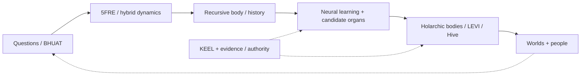
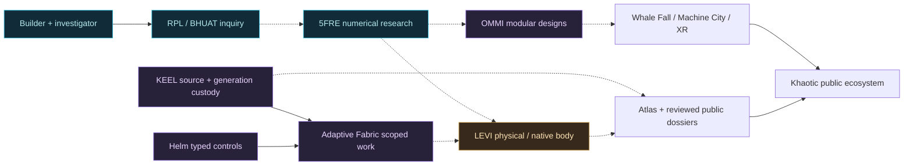

<picture>
  <source media="(prefers-reduced-motion: reduce)" srcset="./assets/khaotic-signature-hero.png" />
  
</picture>

 

**A LIFETIME OF BUILDING. A CAREER OF SOLVING. AN OPEN-ENDED RESEARCH PROGRAM.**

Steven Ray Britt / Mr Khaotic / Sig:KHA &nbsp; | &nbsp; Founder, Khaotic Gaming LLC and Recursive Physics Lab

  

---

## I build things that have to work.

I learned with a hammer in my hands. I grew up around **Amidon Construction**, spent roughly a decade in residential construction and went on to work across industrial fabrication, heavy equipment, maintenance, hydraulic and pneumatic systems, electrical troubleshooting, millwrighting and production leadership. That is **approximately three decades of hands-on building and technical practice**, including early-life experience rather than three decades of formal employment.

I am also a **lifelong old-school gamer**, an autodidact, an investigator and an inventor. I study what I do not yet understand, cross disciplines on purpose, and turn questions into experiments. I founded **Khaotic Gaming LLC** in 2022 and lead a connected program spanning nonlinear mathematical research, physical computing, AI-assisted engineering, interactive worlds and accountable systems.

I know the difference between **a drawing, a working machine, a passing experiment and an untested ambition**. My work preserves all four without pretending they are interchangeable.

 
Different domains. One builder. Research and founding work overlap the industrial career; this is a lineage, not a claim that every activity happened in a strict sequence.

## Choose your entrance

| THE BUILDER / INVENTOR | THE COMPLEX-SYSTEMS RESEARCHER |
| :--- | :--- |
| **[Engineering Resume & Skills](./field-notes/ENGINEERING.md)** Construction since childhood, heavy equipment, industrial machinery, fabrication, hydraulics, pneumatics, controls, crews and management. | **[Whole Research Program](./field-notes/RESEARCH.md)** One source-backed view of the mathematics, bodies, neural learning, hardware, native languages, world engines and products. |
| **[Old-School Gaming & Worldbuilding](./field-notes/GAMING.md)** The lifelong gaming foundation of Khaotic Gaming, interactive systems and immersive-world design. | **[Complex and Hybrid Dynamics](./field-notes/COMPLEX_SYSTEMS.md)** Ordered 5FRE, attractors, viability, event dynamics, chiasms, multiscale geometry, formal methods and physical-law falsifiers. |
| **[My Research Method](./field-notes/METHOD.md)** Self-education, investigation, logical deduction, scientific method and deliberate learning at the edge of my understanding. | **[Recursive Bodies & Autopoiesis](./field-notes/AUTOPOIESIS.md)** History-bearing bodies, nested holarchies, N-body ecology, neural seeds, scar-to-organ experiments and accountable self-construction. |
| **[LEVI, Android & LEVI Air](./field-notes/EMBODIMENT.md)** Physical machines, native computing, Android Wand, robotics research and physical-field/airborne recurrence experiments. | **[Original Languages & Ciphers](./field-notes/LANGUAGES_CRYPTO.md)** TAL, typed body operations, semantic grammars, native compiler research and experimental cryptography. |
| **[World Engines & Khaotic Ecosystem](./field-notes/WORLDS.md)** Whale Fall, Machine City, Garden, Hive, Recursants, XR, games, creator tools, civic and commercial programs. | **[Physical Science & Materials](./field-notes/PHYSICAL_SCIENCE.md)** Percolation, materials, somatic scarring, waves, acoustic bridges, harmonics and physical-model falsification. |

**Research evidence register:** [87 publicly readable research evidence summaries](./field-notes/PROVENANCE.md) based on a documented private-repository review. **Public visual research:** [Khaotic Historical Atlas](https://khaotic.ai/atlas/) / [Research Estate](https://khaotic.ai/atlas/research/). Underlying implementation sources remain private; the public register describes each claim and its limits.

## Three decades at the machine, from the house to the plant

| Period | Experience | What I took into the next chapter |
| :--- | :--- | :--- |
| **Childhood / early years** | **Amidon Construction** and approximately a decade of residential work with dirt, wood, site work, structures and houses | Learn by doing, measure twice, ask questions and take responsibility for the result. |
| **2006-2014** | **Systems LLC** - Lead millwright / fabricator | Structural steel, pipe systems, industrial installations, welding, layout and crew development. |
| **2014-2020** | **Arkansas Mechanical** - Lead millwright / fabricator | Machinery installation, alignment, compressors, turbines, piping and field problem-solving. |
| **2020-2023** | **Atlas Tube** - Lead mechanical maintenance specialist | Preventive maintenance, hydraulic/PLC-controlled machinery, electrical repairs and production fault isolation. |
| **2023-2025** | **Counts Brothers** - Shop foreman | Shop operations, supervision, schedules, budgets, training and customer coordination. |
| **2022-present** | **Khaotic Gaming / RPL** - Founder, investigator, inventor | Research direction, systems architecture, experimental computation, embodied hardware and public experiences. |

The early construction history is my personal account; specific employment dates and responsibilities come from my historical resumes and portfolio. Founder work overlaps other positions. No unstated licenses, degrees or current certifications are implied.

**Core practice:** construction and heavy equipment / welding and fabrication / precision mechanical systems / hydraulics and pneumatics / AC-DC and PLC-related troubleshooting / maintenance and safety / operations and people / Python, Rust, Linux and firmware / mathematical experiments / gaming and XR.

**[Full technical skill map, career history, education and scope](./field-notes/ENGINEERING.md)** &nbsp; | &nbsp; **[Industrial work photographs](https://stevenbritt7117.wixsite.com/stevenbritt)**

---

## The through-line: complex systems that can learn from consequences

The work is broader than an AI model, a five-variable simulation or a proprietary OS. It asks whether an **accountable recursive body** can preserve identity and history, learn bounded behavior, specialize useful components, coordinate with other bodies, move across physical substrates and retain evidence of what it did. It joins complex/hybrid dynamics with nested **holarchic and N-body** architectures, developmental computation, native hardware, language design, security and interactive worlds.

**What is already tangible:** a registered sequential nonlinear map; source and scoped mathematical results; a **five-neuron, 25-parameter trainable learning component**; a validated **toy scar-to-organ event at step 60**; physical CPU/GPU experiment receipts; an Android Wand observer stack; native LEVI CPU/firmware milestones; and original language, compiler and experimental cipher sources. **What remains research:** broad self-directed organogenesis, complete native LEVI GPU/robotics autonomy, full physical-field LEVI Air recurrence, and proof that the proposed models recover fundamental laws of nature.

**[The full research thesis](./field-notes/RESEARCH.md)** / **[Nested holarchies, N-body and neurons](./field-notes/HOLARCHY_NEURONS.md)** / **[Bodies and organogenesis](./field-notes/AUTOPOIESIS.md)** / **[Hybrid dynamics](./field-notes/COMPLEX_SYSTEMS.md)** / **[87-entry public evidence register](./field-notes/PROVENANCE.md)**.

## From physical machines to experimental computation

 
<strong>LEVI / Actual experimental hardware, November 2026.</strong> A genuine operator-display photograph, not an AI render. Its displayed labels are not certification that every feature is commissioned.

My research is not a claim that a new equation has already explained the universe. It is a continuing investigation connected to executable code, physical experiments, test boundaries and preserved source history.

| PROGRAM | PURPOSE AND REALITY CHECK |
| :--- | :--- |
| **BHUAT + 5FRE** | An original mathematical/physical research program involving interacting recursive-state coordinates, nonlinear dynamics, memory, regulation and experimental comparisons. **A proposed interpretation, not established universal physics.** |
| **LEVI** | A physical developmental-computing research chassis and native firmware/software stack. Boot-specific CPU and firmware milestones are recorded; full native GPU admission remains separate ongoing work. |
| **KEEL, Helm, Adaptive Fabric** | Governed source and generation custody, typed operator controls, bounded distributed work, recovery and evidence receipts. Different responsibilities, not a single magical runtime. |
| **OMMI, Whale Fall, Machine City, XR** | Earlier modular-system concepts, browser experiences, geospatial/interactivity research and developing social/product worlds. Implemented surfaces and long-term intentions are distinct. |
| **Holarchic N-body / neural development** | Nested body/organ identities, coupled-kernel ecology and a real five-neuron bounded residual-learning implementation. Full self-growing computational organs remain a staged research program. |
| **LEVI Air / physical-field computing** | Proposed distributed wave-field and dense-cloud computational recurrence with preregistered experiments; **not** a flown aircraft or completed field-carried mind. |
| **TAL / native languages / Khaotic ciphers** | Historical Typed Assembly Language, typed-proof operations, compiler research and experimental finite-bit cipher implementations. The latter have **no production security claim**. |
| **Materials / physics analogues** | Percolation, elasticity, somatic scarring, cymatic/acoustic correspondences, harmonics and target-specific physical-law tests. Mathematical analogies do not establish universal material or physical laws. |

### Selected demonstrations with explicit boundaries

| Recorded evidence | What it demonstrates | What it does *not* demonstrate |
| :--- | :--- | :--- |
| **September 2026 - physical RTX 5060 Ti** | 16 Linux/NVIDIA-driver GPU launches; two frozen binary64 five-field traces matched the tested CPU reference at zero observed ULP error. | Universal CPU/GPU equivalence or fully commissioned native LEVI GPU compute. |
| **September 2026 - cross-machine study** | Seven predeclared initial-condition scales met a finite-horizon amplification criterion in the recorded campaign. | A universal chaos or physics proof. |
| **2026 - LEVI native CPU** | Authenticated 16-way SMP and five-of-five native CPU jobs recorded in specific boot/epoch receipts. | Continuous readiness on every later boot. |
| **2025 and 2026 - patent applications** | U.S. provisional **63/851,781** and nonprovisional **19/755,751** filed. | Granted patents or externally validated research claims. |

**[Review evidence and limitations](./field-notes/EVIDENCE.md)** &nbsp; | &nbsp; **[Trace research dossiers](https://khaotic.ai/atlas/research/)** &nbsp; | &nbsp; **[Read the chronology](./field-notes/HISTORY.md)** &nbsp; | &nbsp; **[Public Adaptive Fabric](https://khaotic.ai/fabric/)**

<strong>EXPAND: HOW THE SYSTEMS CONNECT</strong> (conceptual architecture, not a live-health dashboard)

## Gaming is not a side note

I grew up with games as a medium of systems, strategy, worldbuilding and play. Long before "AI agents" became a product category, I was curious about how virtual worlds work and what could make them more responsive. That lifelong interest belongs next to the construction and research work, not hidden underneath it.

Khaotic Gaming is where I brought the builder's mindset to interactive worlds, geospatial concepts, AI and community experiences. **[The gamer-to-builder story](./field-notes/GAMING.md)** | **[Explore Whale Fall](https://whalefall.khaotic.ai/)** | **[Network and product map](./field-notes/NETWORK.md)**.

## The question that keeps me working

> **Where is my understanding weakest, and what experiment would move it forward?**

I am an autodidact and an investigative polymath. I know some domains through decades of practical experience, others through sustained independent study, and some through continuing research. I do not confuse familiarity with mastery. Biology, physics, computing, mechanics, psychology, art and business interest me because their connections are often more revealing than their labels.

**Observe. Question. Research. Derive. Build. Test. Document. Revise.**

**[Read my research method](./field-notes/METHOD.md)** &nbsp; | &nbsp; **[Selected independent manuscripts](https://independent.academia.edu/KhaoticGaming)**

---

## Evidence and release boundaries

**Public:** selected research summaries, the Historical Atlas, the Research Estate crosswalk, the physical LEVI photograph and public Khaotic/Whale Fall interfaces. **Governed or private:** patent-sensitive implementations, raw source-custody authority, physical operator controls and unpublished internal records. **Still in development:** aspects of native GPU bring-up, wider developmental autonomy, and broader interactive/commerce systems. A release claim is never inferred from an architectural diagram.

## Work with me

I welcome technical collaboration and career opportunities in **complex and hybrid dynamical systems, computational physics, nonlinear numerical methods, formal reasoning, accountable AI, neural learning, recursive/body architectures, native and embedded hardware, industrial automation, materials and field-computing experiments, secure software, language design, interactive worlds and XR**. My practical foundation includes heavy equipment, fabrication, machinery repair and team leadership; my research approach is investigative, cross-disciplinary and test-driven. I bring an existing research program and a willingness to challenge my assumptions with better evidence.

**[Whole Research Program](./field-notes/RESEARCH.md)** &nbsp; / &nbsp; **[Engineering Resume](./field-notes/ENGINEERING.md)** &nbsp; / &nbsp; **[LinkedIn](https://www.linkedin.com/in/steven-britt-kg/)** &nbsp; / &nbsp; **[Research Dossiers](https://khaotic.ai/atlas/research/)** &nbsp; / &nbsp; **[Historical Atlas](https://khaotic.ai/atlas/)** &nbsp; / &nbsp; **[Industrial Portfolio](https://stevenbritt7117.wixsite.com/stevenbritt)**

 

Real machines. Original questions. Dated evidence. Public-facing material is curated; private source, credentials and patent-sensitive implementation remain under governed custody. KEEL is the Khaotic source-generation authority; this GitHub profile is its public-facing introduction, not its replacement.

**Steven Ray Britt / Mr Khaotic / Sig:KHA**

