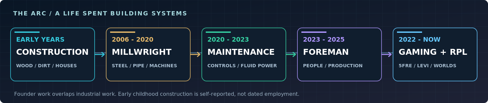
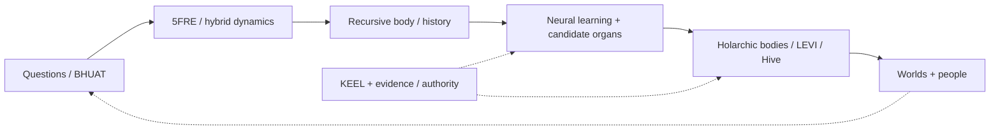
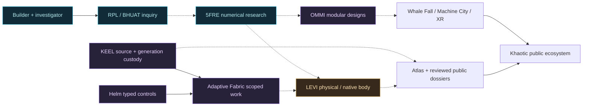

<picture>
  <source media="(prefers-reduced-motion: reduce)" srcset="./assets/khaotic-signature-hero.png" />
  
</picture>

 

**I BUILT HOUSES BEFORE I BUILT COMPUTATIONAL WORLDS.**

Steven Ray Britt / Mr Khaotic / Sig:KHA &nbsp; | &nbsp; Founder, Khaotic Gaming LLC and Recursive Physics Lab

  

---

## BUILDER FIRST. LEAD BY EXPERIENCE. INVENTOR BY NATURE.

**My father was a residential contractor. I grew up on his jobsites—from the time I could hold a hammer until I was about 17.** I wasn't just around construction: I was building houses, from dirt work, site preparation, foundations and concrete through framing, roofing, plumbing, electrical, HVAC, finish work and repairs. I had been working so long I didn't even realize I was supposed to be getting paid until I was **15**.

From there I went into industrial construction and maintenance: **steel, pipe, welding, precision millwrighting, heavy equipment, automated cranes and mill machinery, hydraulics, pneumatics, electrical and PLC-controlled machinery, power plants, vehicles, production lines and the people responsible for keeping them running**. I worked as **Lead Millwright / Fabricator** at Systems LLC and Arkansas Mechanical, **Lead Mechanical Maintenance Specialist** at Atlas Tube, and **Shop Foreman** at Counts Brothers.

My strength isn't one trade. It is being the **do-it-all problem solver and lead** who can arrive at an unfamiliar job, read the plans, understand the equipment, trace the fault, pick up a tool, lead a crew, learn what's missing and get the work done. Approximately **three decades of building and industrial practice** have shaped how I investigate everything—including mathematics, physical computing, and AI.

I'm also a **lifelong old-school gamer, investigative polymath, inventor, and self-taught researcher**. I deliberately go looking for the parts I understand least, because that's where the next question—and often the next invention—starts.

 
From my father's house-building crews to industrial plants, physical computing and original research. The work didn't begin in 2022—and I never stopped building.

**[FULL ENGINEERING RÉSUMÉ](./field-notes/ENGINEERING.md)** &nbsp; · &nbsp; **[THE COMPLETE CAPABILITY ATLAS](./field-notes/CAPABILITIES.md)** &nbsp; · &nbsp; **[PHOTOS OF ACTUAL WORK](https://stevenbritt7117.wixsite.com/stevenbritt)**

## Choose your entrance

| THE BUILDER / INVENTOR | THE COMPLEX-SYSTEMS RESEARCHER |
| :--- | :--- |
| **[Engineering Résumé & Leadership](./field-notes/ENGINEERING.md)** House-building from childhood, heavy equipment, field leadership, power plants, industrial troubleshooting, people and projects.  **[Full Capability Atlas](./field-notes/CAPABILITIES.md)** Construction, civil, mills, welding, fluid power, electrical, engines, business and more. | **[Whole Research Program](./field-notes/RESEARCH.md)** One source-backed view of the mathematics, bodies, neural learning, hardware, native languages, world engines and products. |
| **[Old-School Gaming & Worldbuilding](./field-notes/GAMING.md)** The lifelong gaming foundation of Khaotic Gaming, interactive systems and immersive-world design. | **[Complex and Hybrid Dynamics](./field-notes/COMPLEX_SYSTEMS.md)** Ordered 5FRE, attractors, viability, event dynamics, chiasms, multiscale geometry, formal methods and physical-law falsifiers. |
| **[My Research Method](./field-notes/METHOD.md)** Self-education, investigation, logical deduction, scientific method and deliberate learning at the edge of my understanding. | **[Recursive Bodies & Autopoiesis](./field-notes/AUTOPOIESIS.md)** History-bearing bodies, nested holarchies, N-body ecology, neural seeds, scar-to-organ experiments and accountable self-construction. |
| **[LEVI, Android & LEVI Air](./field-notes/EMBODIMENT.md)** Physical machines, native computing, Android Wand, robotics research and physical-field/airborne recurrence experiments. | **[Original Languages & Ciphers](./field-notes/LANGUAGES_CRYPTO.md)** TAL, typed body operations, semantic grammars, native compiler research and experimental cryptography. |
| **[World Engines & Khaotic Ecosystem](./field-notes/WORLDS.md)** Whale Fall, Machine City, Garden, Hive, Recursants, XR, games, creator tools, civic and commercial programs. | **[Physical Science & Materials](./field-notes/PHYSICAL_SCIENCE.md)** Percolation, materials, somatic scarring, waves, acoustic bridges, harmonics and physical-model falsification. |

**Research evidence register:** [87 publicly readable research evidence summaries](./field-notes/PROVENANCE.md) based on a documented private-repository review. **Public visual research:** [Khaotic Historical Atlas](https://khaotic.ai/atlas/) / [Research Estate](https://khaotic.ai/atlas/research/). Underlying implementation sources remain private; the public register describes each claim and its limits.

## The work history: nearly every role was lead

| Period | Position | Work |
| :--- | :--- | :--- |
| **Childhood – about 17** | **Residential construction with my father / Amidon Construction** | Houses from site preparation to roof: dirt work, concrete, framing, roofing, plumbing, electrical, HVAC, finish and repair. |
[REDACTED - PRIVATE HISTORY]
| **2006–2014** | **Systems LLC — Lead Millwright / Fabricator** | High-pressure pipe, structural steel, welding, industrial installation and field crews. |
| **2014–2020** | **Arkansas Mechanical — Lead Millwright / Fabricator** | Turbines, compressors, machinery installation, precision alignment, fabrication and customer-facing field coordination. |
| **2020–2023** | **Atlas Tube — Lead Mechanical Maintenance Specialist** | Early automated-crane rollout, overhead cranes, slitters, bundlers, steel-processing machinery, hydraulics, pneumatics, PLC-linked equipment, emergency maintenance and crews. |
| **2023–2025** | **Counts Brothers — Shop Foreman** | People, equipment, shop production, schedules, budgets, customers and delivery. |
| **2022–present** | **Khaotic Gaming / Khaotic.ai / RPL — Founder and Inventor** | Mathematics, complex and hybrid dynamics, experimental physical computing, AI, language research and interactive worlds. |

**What this means in the field:** Construction and heavy equipment · Welding and structural fabrication · Turbines, compressors and plants · Hydraulics and pneumatics · AC/DC, PLCs and controls · Cars, trucks and small engines · Road, bridge and waterway jobs · Planning, budgeting, customers and crews · Hands-on troubleshooting across trades.

**[Detailed engineering résumé](./field-notes/ENGINEERING.md)** · **[Capability atlas](./field-notes/CAPABILITIES.md)** · **[Four résumé source versions](./field-notes/CAREER_SOURCES.md)** · **[Industrial photo portfolio](https://stevenbritt7117.wixsite.com/stevenbritt)**

---

## The through-line: complex systems that can learn from consequences

The work is broader than an AI model, a five-variable simulation or a proprietary OS. It asks whether an **accountable recursive body** can preserve identity and history, learn bounded behavior, specialize useful components, coordinate with other bodies, move across physical substrates and retain evidence of what it did. It joins complex/hybrid dynamics with nested **holarchic and N-body** architectures, developmental computation, native hardware, language design, security and interactive worlds.

**What is already tangible:** a registered sequential nonlinear map; source and scoped mathematical results; a **five-neuron, 25-parameter trainable learning component**; a validated **scar-to-organ simulation event at step 60**; physical CPU/GPU experiment receipts; an Android Wand observer stack; native LEVI CPU/firmware milestones; and original language, compiler and experimental cipher sources. **Where the work is going:** developmental organ growth, expanded LEVI compute and embodiment, physical-field computing, and independent experimental challenges to the mathematics. Each area has its own source, experiments, and roadmap.

**[The full research thesis](./field-notes/RESEARCH.md)** / **[Nested holarchies, N-body and neurons](./field-notes/HOLARCHY_NEURONS.md)** / **[Bodies and organogenesis](./field-notes/AUTOPOIESIS.md)** / **[Hybrid dynamics](./field-notes/COMPLEX_SYSTEMS.md)** / **[87-entry public evidence register](./field-notes/PROVENANCE.md)**.

## From physical machines to experimental computation

 
<strong>LEVI / Actual experimental hardware, November 2026.</strong> A genuine photograph of our native computing work, not an AI render.

My research is not a claim that a new equation has already explained the universe. It is a continuing investigation connected to executable code, physical experiments, test boundaries and preserved source history.

| PROGRAM | WHAT WE'RE BUILDING AND INVESTIGATING |
| :--- | :--- |
| **BHUAT + 5FRE** | Original mathematics around nonlinear recurrence, hybrid event dynamics, coupled states, attractors, stability, memory, coherence, regulation and exact-versus-numeric computation. |
| **LEVI** | Physical/native developmental-computing systems: hardware bring-up, firmware, CPU/GPU paths, memory, observations, persistence, communications, source continuity and recovery. |
| **KEEL + Helm + Adaptive Fabric** | Source and generation custody, typed operator control, distributed execution, resources, evidence, review and recovery. |
| **OMMI / Garden / Hive / Recursants** | Persistent recursive bodies, behavior development, bounded learning, adaptation, multi-body coordination and generational history. |
| **Holarchic and N-body systems** | Nested kernels, coupled bodies, neural residual learning, scalable relationships, lineage, specialization, and accountable organogenesis. |
| **TAL, languages and cryptography** | Typed assembly and proof-carrying operations, native language and compiler research, custom cryptographic research and rigorous security testing. |
| **Physical science and LEVI Air** | Waves and fields, materials, percolation, scarring, spatial computation, dense-cloud hypotheses, hybrid physical realizers and experiment design. |
| **Whale Fall, Machine City, XR and gaming** | World engines, geospatial observation, civic data, creative tools, simulated ecologies, social systems, games and multimodal experiences. |

### Results you can investigate

| Recorded result | Evidence |
| :--- | :--- |
| **Physical GPU computation — September 2026** | 16 RTX 5060 Ti Linux/NVIDIA launches; two tested binary64 five-field trajectories matched the CPU reference with zero observed absolute/ULP difference. |
| **Cross-machine replication — September 2026** | Seven preregistered initial-condition scales passed the campaign's finite-horizon amplification criterion, with recorded controls. |
| **Native LEVI CPU and firmware** | Authenticated boot-specific 16-way SMP, native N9 CPU jobs and independently reproduced UEFI builds. |
| **Learning and organogenesis** | Five-neuron, 25-parameter residual learner implemented in source; scar-to-organ simulation validation recorded an organ event at step 60. |
| **Inventor record** | U.S. provisional application **63/851,781** (July 27, 2025) and nonprovisional **19/755,751** (July 27, 2026). |

**[Review the source-backed evidence](./field-notes/EVIDENCE.md)** &nbsp; | &nbsp; **[Trace research dossiers](https://khaotic.ai/atlas/research/)** &nbsp; | &nbsp; **[Read the chronology](./field-notes/HISTORY.md)** &nbsp; | &nbsp; **[Public Adaptive Fabric](https://khaotic.ai/fabric/)**

<strong>EXPAND: HOW THE SYSTEMS CONNECT</strong> (conceptual architecture, not a live-health dashboard)

## Gaming is not a side note

I grew up with games as a medium of systems, strategy, worldbuilding and play. Long before "AI agents" became a product category, I was curious about how virtual worlds work and what could make them more responsive. That lifelong interest belongs next to the construction and research work, not hidden underneath it.

Khaotic Gaming is where I brought the builder's mindset to interactive worlds, geospatial concepts, AI and community experiences. **[The gamer-to-builder story](./field-notes/GAMING.md)** | **[Explore Whale Fall](https://whalefall.khaotic.ai/)** | **[Network and product map](./field-notes/NETWORK.md)**.

## The question that keeps me working

> **Where is my understanding weakest, and what experiment would move it forward?**

I am an autodidact and an investigative polymath. I grew up solving practical problems, then kept studying everything that caught my attention—biology, physics, mechanics, mathematics, electronics, computing, psychology, art, business and more. **I don't wait for a job title to tell me what I can learn.** I find the gap, ask the right questions, work with people who know it, and put the answer to work.

**Observe. Question. Research. Derive. Build. Test. Document. Revise.**

**[Read my research method](./field-notes/METHOD.md)** &nbsp; | &nbsp; **[Selected independent manuscripts](https://independent.academia.edu/KhaoticGaming)**

---

## See the sources. See the machines. See the work.

The public research estate connects the inventions, experiments, hardware, test records, physical photographs and applications. The source-evidence pages carry the detailed methods and current research questions; this front door is about the **person doing the work and the program he is building**.

**[Historical Atlas](https://khaotic.ai/atlas/)** · **[Research Estate](https://khaotic.ai/atlas/research/)** · **[Evidence register](./field-notes/PROVENANCE.md)** · **[Engineering résumé](./field-notes/ENGINEERING.md)** · **[Capabilities](./field-notes/CAPABILITIES.md)**

## Work with me

I bring **three decades of building and leading the work**—from residential construction and heavy equipment to industrial plants, fabrication, controls, maintenance, crews and business—plus an original research program in complex systems, mathematics, physical AI, nonlinear and hybrid dynamics, native hardware, languages, secure computation and interactive worlds. I can lead, build, troubleshoot, learn, collaborate and deliver. I want to work with people and organizations ready to do substantial work across disciplines.

**[Whole Research Program](./field-notes/RESEARCH.md)** &nbsp; / &nbsp; **[Engineering Résumé](./field-notes/ENGINEERING.md)** &nbsp; / &nbsp; **[Capability Atlas](./field-notes/CAPABILITIES.md)** &nbsp; / &nbsp; **[LinkedIn](https://www.linkedin.com/in/steven-britt-kg/)** &nbsp; / &nbsp; **[Research Dossiers](https://khaotic.ai/atlas/research/)** &nbsp; / &nbsp; **[Historical Atlas](https://khaotic.ai/atlas/)** &nbsp; / &nbsp; **[Industrial Portfolio](https://stevenbritt7117.wixsite.com/stevenbritt)**

 

Real work. Real machines. Original research. Built from the ground up. Khaotic source and patent-sensitive systems remain under their existing custody.

**Steven Ray Britt / Mr Khaotic / Sig:KHA**

