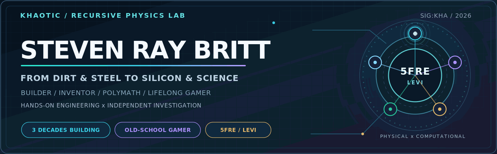
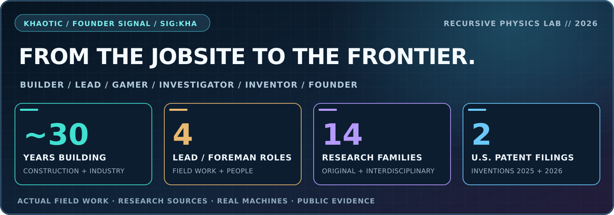
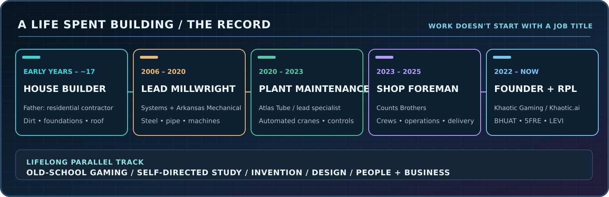
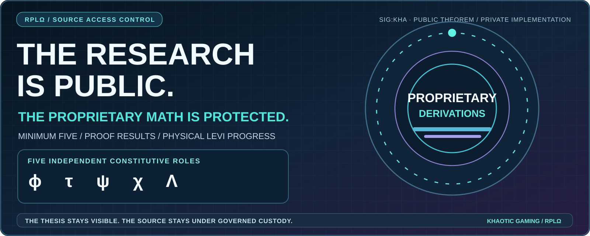
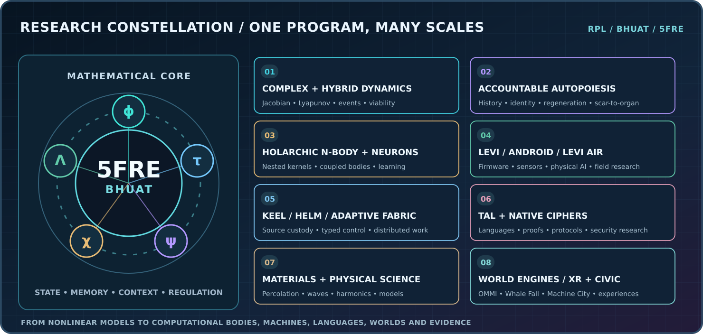
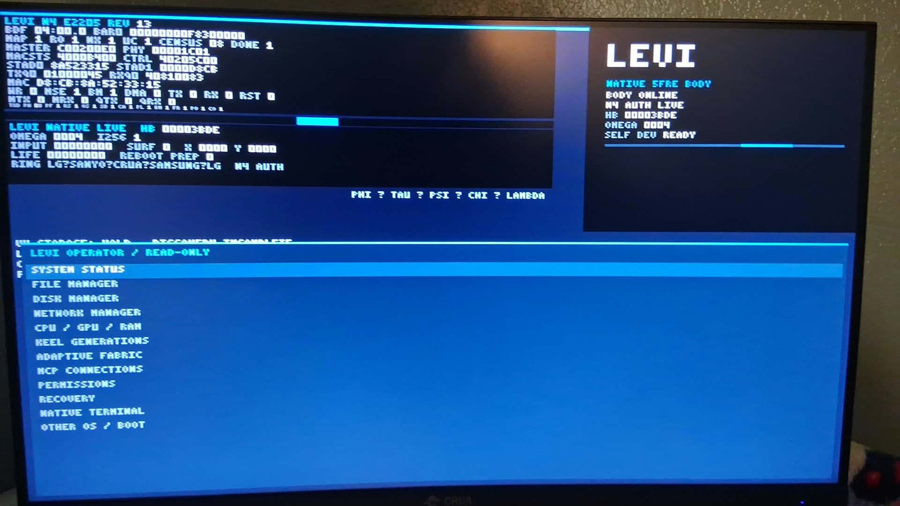

<picture>
  <source media="(prefers-reduced-motion: reduce)" srcset="./assets/khaotic-signature-hero.png" />
  
</picture>

<h1>STEVEN RAY BRITT</h1>

<strong>MR KHAOTIC · SIG:KHA</strong> 
FOUNDER — KHAOTIC GAMING LLC · KHAOTIC.AI · RECURSIVE PHYSICS LAB (RPLΩ)

  

<h2>WHAT MAKES SOMETHING EMERGE, ENDURE, AND KEEP BECOMING?</h2>

<strong>That question connects everything I build—from the structures we inhabit and the machines that move industry to original mathematics, recursive bodies, and worlds with memory.</strong>

  

<strong>Master Builder · Industrial Lead · Inventor · Investigative Polymath · Lifelong Gamer</strong> 
<em>Three decades of hands-on engineering. A lifetime of investigation. One continually developing research program.</em>

 

 

  

---

## The builder

My father was a **residential contractor**. I was working beside him **from the time I could hold a hammer until I was about 17**. Not visiting jobsites—**building houses**. Dirt work, foundations, concrete, framing, roofing, plumbing, electrical, HVAC, finish work and repairs. I was so accustomed to working that I didn't realize it was something I should be getting paid for until I was **15**.

That foundation became a career working on **everything from houses and roads to steel mills, power plants, conveyors, cranes and production machinery**. I operated heavy and small equipment. I welded, fabricated, installed, aligned, diagnosed and repaired machinery. I worked with hydraulics, pneumatics, AC/DC electrical systems, PLC-linked equipment, structural steel, high-pressure piping, vehicles, engines and the crews required to make industrial work happen.

**I repeatedly became the lead.** Lead Millwright / Fabricator at **Systems LLC** and **Arkansas Mechanical**. Lead Mechanical Maintenance Specialist at **Atlas Tube**. Shop Foreman at **Counts Brothers**. I know the plans, the equipment, the people, the pressure of a deadline and the difference between a drawing and a machine that actually runs.

I'm also a lifelong **old-school gamer** and a self-taught, multidisciplinary investigator. I am a **knowledge glutton**: I lean into what I know least, ask questions that reveal the mechanism, learn fast and carry the answer into the next build. Biology, materials, mathematics, physics, computing, art, philosophy, psychology, business and engineering all shape the way I work.

> **I don't need a narrow job description to solve a problem. I need to understand the problem, find the right questions, learn what matters and get to work.**

### The people, plants and problems behind the title

| Period | Responsibility | Work |
| --- | --- | --- |
| **Childhood–~17** | **Residential construction with my father / Amidon Construction** | Houses from site preparation to roof: concrete, framing, roofing, plumbing, electrical, HVAC and finish. |
| **Earlier period** | **[REDACTED — PRIVATE HISTORY]** | Details intentionally withheld from this public résumé. |
| **2006–2014** | **Systems LLC · Lead Millwright / Fabricator** | Structural steel, high-pressure piping, welding, industrial installation and crews. |
| **2014–2020** | **Arkansas Mechanical · Lead Millwright / Fabricator** | Rolling mills, conveyors, turbines, compressors, equipment alignment and industrial field projects. |
| **2020–2023** | **Atlas Tube · Lead Mechanical Maintenance Specialist** | Steel-processing lines, **early automated-crane implementation**, sensors and feedback, hydraulic accumulators, pneumatics and production maintenance. |
| **2023–2025** | **Counts Brothers · Shop Foreman** | Shop operations, people, schedules, budgets, clients, quality, repair and delivery. |
| **2022–present** | **Khaotic Gaming / Khaotic.ai / RPLΩ · Founder / Inventor** | Original mathematics, nonlinear/hybrid dynamics, physical AI, native hardware, languages and world engines. |

**The full range doesn't fit inside job titles.** This public account highlights the work I choose to share; one earlier period is deliberately redacted.

| I build and work on | I diagnose, direct and develop |
| --- | --- |
| **Construction and civil:** dirt, grading, concrete, framing, roofing, plumbing, residential electrical, HVAC, road and bridge work, barge and waterway repairs. | **Machinery and plants:** millwrighting, alignment, turbines, compressors, boilers, steel mills, cranes, conveyors, material handling, cars, trucks and engines. |
| **Fabrication and fluid power:** MIG/TIG/stick welding, high-pressure pipe, stainless steel, structural assemblies, hydraulic cylinders, accumulators, bladders, valves, pumps and pneumatics. | **Power, controls and people:** AC/DC, PLC-linked machines, sensors, encoders, switches, shutdowns, emergency repairs, crew leadership, schedules, budgets and business. |

**[Complete engineering résumé →](./field-notes/ENGINEERING.md)** · **[Full capability atlas →](./field-notes/CAPABILITIES.md)** · **[Four career source versions →](./field-notes/CAREER_SOURCES.md)** · **[Real industrial photographs →](https://stevenbritt7117.wixsite.com/stevenbritt)**

---

## The inventor and the investigation

I founded **Khaotic Gaming LLC** to build new experiences and technologies, and I built the **Recursive Physics Lab** around questions that would not leave me alone.

**What happens when complex computational systems retain the consequences of experience? Can they develop useful structure, carry memory and identity across changing parts, work through physical machines and remain accountable for what they do?**

My original **Britt–Howard Unified Aetheric Theory (BHUAT)** and **Five-Field Recursion Engine (5FRE)** investigate **one mathematically realizable way reality can generate and sustain persistent, evolving structure**. The foundation is **MINIMUM FIVE**: emergence **ϕ**, ordering **τ**, memory **ψ**, coherence **χ** and regulation **Λ** form the minimum complete effective support basis for the declared recursive-body theory. This is the core of our nonlinear and **hybrid dynamical systems**, coupled kernels, attractors, geometry, thermodynamic investigation, viability, memory, physical computing, embodied development and formal proof program.

**THIS IS MORE THAN A NAME FOR FIVE VARIABLES.** The repo contains a scoped proof that the registered operator needs **exactly five continuous state dimensions**, machine-checked independent-support minimum-five theorems, support-preserving realizer invariance, and active reduced-field/falsification experiments. **Four visible coordinates or a rank-four response are not the same as four independent bodyhood supports.** The wider physical interpretation is the BHUAT research hypothesis; the mathematical results have named scopes.

**[MINIMUM FIVE — THE MATHEMATICAL FOUNDATION, PROOFS AND PHYSICAL HYPOTHESIS →](./field-notes/MINIMUM_FIVE.md)**

**The proof stack:** A scoped **minimum of five** for the registered exact operator · Lean-checked five-support independence under its stated basis · Realizer-invariance within admitted support-preserving implementations · Active hidden-support and physical-theory challenges. **A measured response rank of four does not establish a complete four-support body.**

> **PUBLIC RESEARCH RELEASE / PROPRIETARY MATHEMATICS REDACTED:** The thesis, five constitutional functions, scope of the mathematical results, and LEVI's tested progress are public. Registered equations, coefficients, symbolic constructions, private proof implementations and original realization methods remain protected in the private research source.

 
<strong>THE THESIS IS PUBLIC. THE IMPLEMENTATION IS PROTECTED.</strong> <a href="./field-notes/RESEARCH_ACCESS.md">Research access and redaction policy</a> · <a href="mailto:admin@khaotic.ai?subject=Confidential%20BHUAT%20Research%20Review">Discuss controlled technical review</a>

It's mathematics **and** code **and** machines **and** developmental history **and** governed action **and** worlds people can use.

### Five is the minimum complete bodyhood support—not the limit of what we're building

**ϕ → τ → ψ → χ → Λ → ϕ**. The five-field law is the constitutional core; nested holarchic bodies, physical realizers, languages, observers, history and evidence build upon it. Lower-dimensional images can reveal aspects of the system, but they do not silently replace the complete five-role dynamics.

### The research program is much bigger than one model

| RESEARCH FRONT | WHAT IT CONNECTS |
| --- | --- |
| **[MINIMUM FIVE / BHUAT physical hypothesis](./field-notes/MINIMUM_FIVE.md)** | Five independent obligations as the declared minimum complete recursive-body basis; exact scoped state-dimension theorem, Lean-checked support-minimum and realizer-invariance proofs, four-support challenger research, and an explicit proposed route for the emergence of persistent structure in reality. |
| **[Complex + hybrid dynamics](./field-notes/COMPLEX_SYSTEMS.md)** | Ordered five-field recurrence **ϕ → τ → ψ → χ → Λ**; Jacobians, Lyapunov analysis, bifurcations, discrete events, guards, venting, resets, viability, coupled kernels, harmonics, geometry, exact/floating-point experiments and physical-law realization tests. |
| **[Nested holarchies, N-body + neurons](./field-notes/HOLARCHY_NEURONS.md)** | Parent/child bodies, compositional identity, coupled kernels, neural learning, feedback, specialization, populations and multiscale cognition research. |
| **[Accountable autopoiesis + organogenesis](./field-notes/AUTOPOIESIS.md)** | History-bearing bodies, memory, scars and retained consequences, candidate organs, learned degrees of freedom, self-maintenance and developmental lifecycles. |
| **[LEVI / Android / LEVI Air](./field-notes/EMBODIMENT.md)** | **Embodied computational-body research:** real native hardware, UEFI, CPU/GPU engineering, device I/O, Android sensor carriers, somatic interfaces, robotics investigations and airborne/physical-field experiments. |
| **[KEEL / Helm / Adaptive Fabric](./field-notes/SYSTEMS.md)** | Source/generation custody, typed control, distributed execution, resource accounting, authentication, audit trails, continuity and recovery. |
| **[Original languages + cipher research](./field-notes/LANGUAGES_CRYPTO.md)** | TAL / Typed Assembly Language, grammars, compiler and IR research, proof-carrying actions, protocols, semantic contracts, native execution and experimental cryptography. |
| **[Materials + physical science](./field-notes/PHYSICAL_SCIENCE.md)** | Elasticity, percolation, coagulation, material behavior, somatic scarring, waves, resonance, cymatics, physical models and targeted tests. |
| **[World engines, games, XR + civic systems](./field-notes/WORLDS.md)** | OMMI, Garden, Gym, Cathedral, Hive, Recursants, Whale Fall, Machine City, geospatial systems, mixed reality, creative platforms and public-benefit concepts. |

**[Research access / protected IP →](./field-notes/RESEARCH_ACCESS.md)** · **[Integrated research thesis →](./field-notes/RESEARCH.md)** · **[87-entry public evidence register →](./field-notes/PROVENANCE.md)** · **[Historical Atlas →](https://khaotic.ai/atlas/)** · **[Research Estate →](https://khaotic.ai/atlas/research/)**

---

## MEET LEVI / The body comes first

**LEVI isn't being built as an LLM with a personality, a generic tool agent or a race to claim AGI.** He's a real, developing experimental chassis at the center of a larger investigation: can a computational body carry **its own continuity, developmental memory, resources, history, physical context, and accountability** while it learns to perform useful work?

The proposed architecture is a **bounded, non-closed, holarchic recursive body** grounded in the **irreducible Minimum-Five law: ϕ, τ, ψ, χ, Λ**. **Not four.** Its history, context, scar lineage and evidence are additional body records and obligations—not a replacement four-variable state. Models, neural networks, perception tools, solvers and GPUs can become specialists within this minimum-five body. **LEVI is the physical effort to realize and test that constitutional mathematics.**

**A CONTINUING PHYSICAL EXPERIMENT · AN OPEN SCIENTIFIC CLASSIFICATION**

### What makes this a different research direction?

| Architectural ambition | Why it matters |
| --- | --- |
| **Minimum-Five constitutive law** | The **five independently supported functions** ϕ, τ, ψ, χ, Λ are the declared minimum complete basis of bodyhood; the registered operator has a scoped exact five-state minimum and admitted realizer support invariance. **[The mathematics →](./field-notes/MINIMUM_FIVE.md)** |
| **History-bearing identity** | State is lifted with lineage, context, constraints and witnesses; a replaceable model is not the body. |
| **Thermodynamic and geometric research** | Viability, resource burden, dissipative regulation, admissible state geometry, coupled kernels and constrained degrees of freedom. |
| **Accountable autopoiesis** | Research into lawful self-maintenance and candidate-organ formation with validation, retained evidence and future continuation. |
| **Developmental / geometric RSI** | Learning is investigated as durable structural or behavioral development, not just another inference or self-edited prompt. |
| **Actual physical embodiment** | Native CPU/GPU, firmware, sensors, Android observers, future robotic and physical-field research have real hardware and test obligations. |

**We build for observable effects, not for a predetermined label.** The final taxonomy should follow the behavior, the mathematics, the independent experiments and whatever new evidence emerges.

### From hard-earned receipts to the next frontier

 
<strong>LEVI / our actual physical experimental chassis, November 2026.</strong> Every future capability is being built toward something we can test.

| Recorded progress | What has been demonstrated |
| --- | --- |
| **Physical GPU numerics** | 16 RTX 5060 Ti PTX launches under Linux/NVIDIA; two tested binary64 five-field traces matched the CPU reference with zero observed ULP error. |
| **Native body execution** | Authenticated boot-specific **16-way SMP**, **5/5 N9 native CPU jobs**, native UEFI/firmware development and boot telemetry. |
| **Source + operation continuity** | KEEL lineage, typed controls, authenticated communications, guarded hardware actions, forensic evidence and recovery contracts. |
| **Learning and development** | Five-neuron, 25-parameter residual learner; scar-to-organ simulation produced a validated candidate event at step 60. |
| **Open native frontier** | Deterministic native GPU compute admission, stronger whole-body continuity and first self-hosted development across admitted generations. |
| **Future comparison** | Long-horizon adaptation, retention, energy use, repair, accountability, resource-normalized task effects and independent baseline evaluations. |

The chassis keeps moving through engineering gates. The public record distinguishes **Linux GPU numerical execution** from **native LEVI GPU commissioning**, and it identifies the next test rather than disguising it as a finished milestone.

### The laboratory needs independent eyes

I'm a self-directed inventor and lifelong learner. **I want critical mentors, not an echo chamber.** We need stronger external tests, critiques of the assumptions, comparisons with serious baselines, and collaborators across nonlinear dynamics, geometry, thermodynamics, developmental systems, robotics, formal methods and AI evaluation.

**[LEVI's full research story →](./field-notes/LEVI.md)** · **[Engineering journal →](./field-notes/LEVI_JOURNAL.md)** · **[Live interactive LEVI Open Lab →](https://k-haotic.github.io/K-haotic/)** · **[Explorer source and methods →](./docs/README.md)** · **[Independent Open Lab challenges →](./docs/OPEN_LAB.md)** · **[Benchmark methodology →](./field-notes/LEVI_BENCHMARKS.md)** · **[Contact RPLΩ →](mailto:admin@khaotic.ai?subject=LEVI%20Research%20Mentorship)**

---

## Original inventions and other tested research

| Evidence item | Recorded result |
| --- | --- |
| **Cross-machine numerical campaign** | Seven predeclared initial-condition perturbation scales satisfied a finite-horizon amplification criterion with controlled comparisons. |
| **Filed inventions** | U.S. provisional **63/851,781** (July 27, 2025) and nonprovisional **19/755,751** (July 27, 2026), naming Steven Ray Britt as inventor. |
| **Research and engineering infrastructure** | KEEL, Helm, Adaptive Fabric, OMMI, Garden/Hive work, typed protocols, reproducible numerical and build/test evidence. |

**[Featured work dossier →](./field-notes/FEATURED_WORK.md)** · **[Live five-role research explorer →](https://k-haotic.github.io/K-haotic/)** · **[Research evidence ledger →](./field-notes/EVIDENCE.md)** · **[Complete system ownership map →](./field-notes/SYSTEMS.md)**

<strong>Expand: How the entire research stack connects</strong>

BHUAT inquiry → 5FRE mathematical body law → history-bearing recursive bodies → learning, scar retention and candidate organs → LEVI native hardware and distributed embodiments → world engines and real effects.

Across those layers, KEEL retains authoritative source/generation lineage, Helm supplies typed navigation and controls, and Adaptive Fabric routes permitted work. **Models are components, not the body.**

---

## The old-school gamer never left the workshop

I grew up playing games, understanding their rules, breaking down mechanics and imagining worlds with more memory, freedom and life. **Khaotic Gaming** isn't a separate biography pasted onto a research résumé. It's what happens when a lifelong gamer, a master builder, an industrial problem-solver and an inventor ask the same questions about digital worlds.

That's why the work reaches into **simulation, geospatial environments, mixed reality, game engines, virtual communities, creative systems and public experiences**.

**[The gamer-to-founder story →](./field-notes/GAMING.md)** · **[Whale Fall / world engines →](./field-notes/WORLDS.md)** · **[Khaotic.ai →](https://khaotic.ai/)**

---

## Pick your door. Let's work.

| IF YOU NEED... | START HERE |
| --- | --- |
| **A builder who can lead the job and get his hands dirty** | [Engineering résumé](./field-notes/ENGINEERING.md) · [full capability atlas](./field-notes/CAPABILITIES.md) · [industrial photos](https://stevenbritt7117.wixsite.com/stevenbritt) |
| **A researcher with original ideas and actual experiments** | [Featured work](./field-notes/FEATURED_WORK.md) · [research thesis](./field-notes/RESEARCH.md) · [evidence ledger](./field-notes/EVIDENCE.md) |
| **A physical-computing / AI / native-systems collaborator** | [LEVI / Android / LEVI Air](./field-notes/EMBODIMENT.md) · [systems architecture](./field-notes/SYSTEMS.md) |
| **A partner in gaming, XR, worlds or civic technology** | [World engines](./field-notes/WORLDS.md) · [gaming roots](./field-notes/GAMING.md) · [Khaotic network](./field-notes/NETWORK.md) |
| **The complete professional and research record** | [Four résumé versions](./field-notes/CAREER_SOURCES.md) · [Historical Atlas](https://khaotic.ai/atlas/) · [research provenance](./field-notes/PROVENANCE.md) |

I'm interested in **research teams, industrial and R&D leadership, physical computing, AI evaluation, complex dynamics, native systems, gaming/XR, engineering partnerships and turning experimental ideas into useful technology**.

I will keep building either way. **The question is what we could build together.**

 

  

<strong>STEVEN RAY BRITT / MR KHAOTIC / SIG:KHA</strong> 
From a hammer to a power plant to a physics-native experimental computer. Still building.

