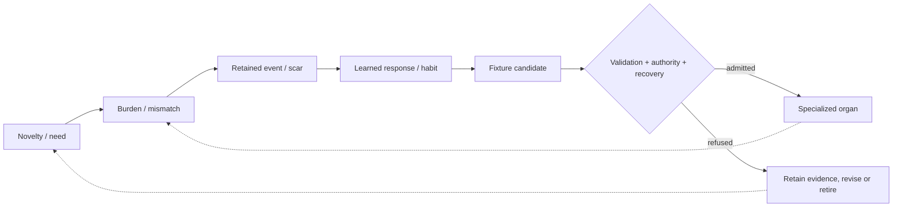

# ACCOUNTABLE RECURSIVE BODIES / ORGANS / HOLARCHIC ECOLOGIES

[Front door](../README.md) | [Research thesis](RESEARCH.md) | [Complex dynamics](COMPLEX_SYSTEMS.md) | [Embodiment](EMBODIMENT.md) | [Holarchy and neurons](HOLARCHY_NEURONS.md) | [Public evidence summaries](PROVENANCE.md)

## The fundamental distinction: model versus body

A language model, neural component or process can be swapped. The proposed *recursive body* is a larger history-bearing object founded on the **irreducible Minimum-Five operational law**:

**Xₙ = (ϕₙ, τₙ, ψₙ, χₙ, Λₙ)** — emergence, ordering, memory, coherence and regulation.

The body also retains **history, source lineage, contextual constraints, resources, scarring, authority and witnessed evidence**. Those additional developmental records do **not** collapse the five obligations into a four-field state. Its legal update includes more than copying numerical coordinates; continuing identity depends on inherited conditions and whether lawful continuation remains possible. **[Minimum Five is the constitutive starting point](MINIMUM_FIVE.md).**

```text
current state != whole body
saved checkpoint != lived history
replayed outputs != original causal evidence
process clone != authorized descendant
```

The source formalization explicitly notes that representability (you can encode the state) does not guarantee viability (the system can continue in the admitted region). This distinction motivates the broader governance architecture (R18, R19).

## Accountable autopoiesis: the technical research program

**Autopoiesis** traditionally has a biological meaning. Within this engineering project, **accountable autopoiesis** is defined more narrowly as governed self-maintenance and regeneration of selected continuing structures while preserving the obligations that allow the system to remain the same accountable computational body.

A candidate update must have a localized reason to exist, a proposed fixture, pre-admission validation, compatible authority, preserved witnesses, a legitimate identity transition, resource solvency and recoverable alternatives. The proof-obligation ledger contains elementary results, conditional theorems **and explicit open conjectures**. It does not establish that LEVI is biologically alive, conscious, indefinitely persistent or free to rewrite its constitution (R20-R21).

## The developmental hypothesis: how a capability becomes an organ



A **scar** here is not merely a stored timestamp or a dramatic word for damage. The strong operational proposal says it must make a measurable difference to future routing, constraints, burden-handling or viable continuation. A **candidate organ** is not automatically admitted because a simulation labeled it one. It must meet functionality, compatibility and evidence criteria (R22-R28).

### A real, narrow experimental witness

The repository has an executable **scar-to-organ toy simulator** and a recorded 160-step validation output. Its declared synthetic threshold was crossed at **step 60**, with the validator reporting zero errors. This is credible evidence that the specified toy mechanism executes and emits a checkable record. It is *not* evidence of a real growing biological organ, a self-modifying deployed OS, or a theorem about all self-organizing systems. See R24-R26.

## Nested holarchies and N-body recursion

The theory does not stop at one body. It examines nested **body atoms -> cells -> tissues -> organs -> bodies -> coupled bodies -> populations/institutions**, with constituent identity and burden intact. A local body can have its own cadence, boundary, evidence and viability limits even when it contributes to a larger body.

The holarchic event contract includes instance identifiers, archetypes, parent relations, frames, pressure state, lambda-lock and witness maturity. Its examples include a somatic Android body and a nested pressure-accumulator organ; the contracts are not physical telemetry proof for a live actuator (R58-R62).

'N-body' in this program describes *interacting recursive bodies* at multiple scales. It does not, by name alone, claim a novel closed-form solution to Newtonian gravitational N-body dynamics. The research asks how identities, causal structure, synchronization, available resources and viable futures are composed, including when a body buds, branches, fuses or retires.

## Learning is not collapsed into organ growth

A source-backed neural seed uses **five trainable field-local neurons and 25 parameters** as a bounded residual around a known ordered 5F map. That is a real implemented neural component, not a demonstration that autonomous neurons or consciousness have spontaneously emerged. A separate topological-network document proposes future structured inference paths and growth of specialist cells. The source separates learner weights, field observations, model checkpoints and operational authority (R63-R65).

## Garden, Gym, Cathedral, Hive and Recursants

The intended developmental ecology gives different roles to different environments. **Garden** cultivates possibilities, **Gym/Arena** measures behavior in bounded tasks, **Cathedral** classifies and reviews, **Hive** supports cooperation without absorbing raw private identity, and **Recursants** represent specialist persistent-body concepts with lifecycle distinctions. A game-facing Egg, seasonal population or ranking can be a useful testing interface without automatically granting real-world actuation or account privileges (R27, R30-R34, R42-R44, R62).

A key correction from the October whole-system audit is that a **role** is not necessarily a running agent; a **building** is not a live service; and **a child process** is not the same identity as a governed descendant. Respecting those distinctions prevents architecture from being marketed as deployment.

## What would establish stronger results?

| Question | Needed evidence |
| --- | --- |
| Does a scar matter? | Paired same-state controls with/without accepted history; measurable later routing differences. |
| Did a behavior stabilize? | Repeat interventions, held-out environments, useful performance under resource and negative-control budgets. |
| Is it a functional organ? | Specialization, bounded interface, fault recovery, counterfactual removal, local/global compatibility, stable identity. |
| Did accountable self-replacement work? | Authorized candidate creation, independent validation, witnessed selection, source/generation custody, rollback/LKG and post-change behavior. |
| Is an N-body ecology sustainable? | Local/global solvency under load, refusal and failure, independent identity/lineage and meaningful coordination. |
| Is there biological equivalence? | Separate biological criteria and experimental measures; software metaphors are insufficient. |

The research objective is **development with consequences and accountability**. That is challenging enough without prematurely claiming artificial life.

**Primary internally reviewed source families:** R18-R34, R42-R44, R58-R65. [Public evidence register](PROVENANCE.md).
