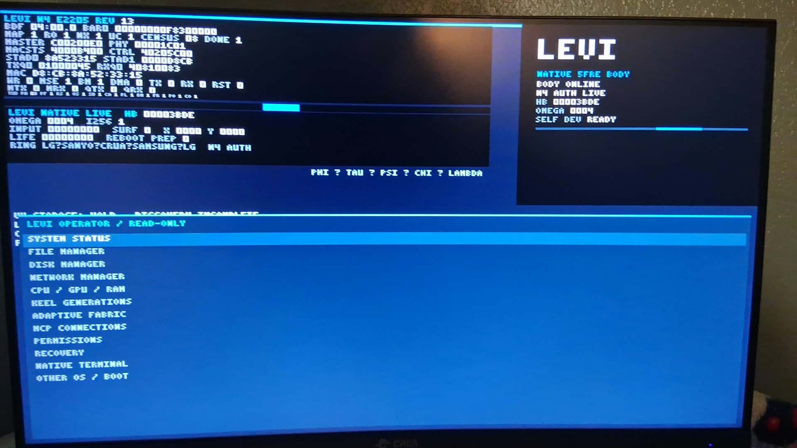

# LEVI / THE ENGINEERING JOURNAL
### Real hardware · Source-backed milestones · Continuing experiment

 
<b>Actual LEVI chassis</b> · Photo from November 2026 · The picture shows the machine; dated receipts establish each experimental result.

**[Meet LEVI](LEVI.md)** · **[Research front door](../README.md)** · **[Proof ladder](LEVI_PROGRESS.md)** · **[Benchmark methodology](LEVI_BENCHMARKS.md)** · **[Interactive explorer source](../docs/index.html)**

## Why keep a journal?

LEVI is a **physical, experimental realization of BHUAT/5FRE's proposed Minimum-Five recursive body law**. At the root are **ϕ emergence, τ ordering, ψ memory, χ coherence and Λ regulation**—the declared minimum complete independent functional basis. The program asks whether this is one physical route through which reality can sustain persistent structure. The journal follows those exact mathematics into actual native computation, device observation, memory, lineage, self-maintenance and future developmental autonomy. **[Minimum-Five mathematical and physical research foundation](MINIMUM_FIVE.md).**

The point is not to declare a static launch or wait for one enormous result. **The engineering progress is the story**: formal definitions, software, boot and firmware development, CPU acceptance, GPU tests, transport, repairs, telemetry, evidence preservation and each next gate.

This is **a dated research journal, not an automatic real-time dashboard**. All entries refer to a particular experiment, branch, receipt or reported source history; no live counts are extrapolated.

## Recorded checkpoints

### 2025 — Original invention and research foundation
- The Five-Field Recursion Engine (5FRE) and Britt–Howard Unified Aetheric Theory (BHUAT) establish the **Minimum-Five** mathematical and physical-theory research direction: five irreducible bodyhood obligations, a registered nonlinear ordered map, exact local state-dimension theorem and conditional effective-support proof program.
- U.S. provisional filing **63/851,781** recorded on July 27, 2025.

**Research meaning:** a named invention and investigable model precede a future physical body.

### September 2026 — Physical GPU numerical witnesses
- The recorded RTX 5060 Ti / Linux-NVIDIA PTX campaign completed **16 launches**.
- Two frozen binary64 five-field traces matched tested CPU references at **zero observed ULP error**.
- Seven predeclared initial-condition perturbation scales passed the finite-horizon comparison criterion in the recorded cross-machine campaign.

**Research meaning:** the mathematical program was executed on physical GPU hardware and cross-machine conditions; test scope and precision are part of the claim.

### October 2026 — Native body and custody engineering
- LEVI native firmware and boot work moved through staged CPU16 and symmetric multiprocessing acceptance.
- The project developed native N9 execution, communication, boot-bound identity, cryptographically authenticated state and recovery constraints.
- Source and release discipline matured around KEEL, authored revisions, execution receipts and successor handling.

**Research meaning:** continuing physical work establishes a reproducible substrate for state-bearing computation rather than merely running a model in a host application.

### October 31–November 1, 2026 — Native CPU progress, GPU and peripheral frontiers
- Authenticated **SMP16**, Stage-9 and **N9 CPU execution** were recorded for specific native boot epochs.
- GPU initialization and its native GSP/command-response path required careful reconciliation. A spent attempt cannot be treated as unspent because a new source patch is available.
- USB xHCI / Android Wand device onboarding remained a separate active integration lane.

**Research meaning:** physical integration requires memory of what actually happened at the device and boot level.

### November 2, 2026 — Authenticated telemetry and protected GPU investigation
- The documented running boot retained CPU/N9 and COT evidence while telemetry continued advancing.
- The contemporaneous GPU terminal classified native initialization as **RECOVERY_REQUIRED_NO_RETRY** for that boot. This journal does **not** authorize or suggest replaying the GPU initialization.
- Source-only GPU transport, sequence handling and HOME packet-ingress work progressed independently of a new physical GPU attempt.

**Research meaning:** progress includes fault isolation, preserved state and safe development even when a hardware gate is not yet closed.

### November 3, 2026 — Research visibility and public synthesis
- Reviewed research dossiers, Atlas graph lineage links and public-facing research documentation were integrated in the maintained source history.
- The GitHub profile expanded the professional and scientific presentation; this journal and the interactive explorer make the underlying progress more inspectable.

**Research meaning:** better public evidence and reproducibility support independent scrutiny. This is a publishing/continuity milestone, not proof of a fresh chassis hardware transition.

## What we are working toward

| Gate | Acceptance evidence we want | Current public classification |
| --- | --- | --- |
| **Native GPU compute admission** | Correct authenticated native device/GSP/RM path, bounded deterministic GPU work and reproduced output. | **OPEN ENGINEERING FRONTIER** |
| **Whole-body persistence** | Body history, constraints, source lineage and evidence survive a declared restart/migration without silent substitutions. | **ACTIVE RESEARCH / PARTIAL SUBSYSTEM EVIDENCE** |
| **Self-hosted development across generations** | An admitted N→N+1→N+2 sequence, with replay and independent identity/provenance witnesses. | **OPEN DEVELOPMENTAL GATE** |
| **Admitted organogenesis** | Candidate organ produced, prevalidated, scoped, useful on held-out tasks and consistent with obligations and resource budget. | **SIMULATION AND FORMALIZATION RESEARCH** |
| **Independent comparison** | Preregistered controls, matching compute/tool budget, transparent metrics and review by external evaluators. | **BENCHMARK DESIGN, NO LEVI-VS-BASELINE RESULT** |
| **Human-facing experiences** | Bounded physical/digital interactions, reproducible effects and rights-aware communication interfaces. | **ONGOING SUBSYSTEM AND PRODUCT PROGRAMS** |

## What a real breakthrough should look like

A convincing result is not just a video, benchmark score or self-description. It needs:
1. **The exact version and execution substrate** that performed the work.
2. **The declared objective, constraints and acceptance gate** established in advance.
3. **A recorded effect**—numeric, physical, behavioral or developmental.
4. **The resource, time and authorization costs** of that effect.
5. **A comparison or negative control** capable of challenging the claimed mechanism.
6. **A witness and a repair path**, including failure cases and continuity of evidence.

The ambition is large: **bounded developmental autonomy on an accountable physical recursive body**, with measurable long-term consequences. That's why a durable journal matters.

## A call for critical collaborators

I want collaborators who can do more than celebrate the idea: experimental physicists, nonlinear-dynamics specialists, systems and firmware engineers, AI/ML evaluators, statisticians, developmental biologists, thermodynamics researchers and formal-methods practitioners willing to identify better tests, missing mechanisms and alternate explanations.

**[Propose a benchmark or independent review](mailto:admin@khaotic.ai?subject=LEVI%20Independent%20Experiment)** · **[Benchmark protocol](LEVI_BENCHMARKS.md)** · **[Full LEVI research dossier](LEVI.md)**

---

Public evidence chronology as reviewed November 3, 2026. Do not interpret an older boot's numerical counts as the current real-time chassis state. The authoritative physical execution and source receipts remain under their original governed custody.
