# LEVI / BUILD LOG AND PROOF LADDER
### Physical chassis · Native computing · Recursive-body development

[LEVI flagship](LEVI.md) · [GitHub front door](../README.md) · [Benchmark design](LEVI_BENCHMARKS.md) · [Research evidence](EVIDENCE.md)

> **The machine is a working research program, not a static illustration. Its state of development changes through experiments, versions, tests and physical integration.**

**Last public research-ledger review: November 3, 2026.** The dated evidence below reflects **records through November 2, 2026**; this document is **not a live chassis sensor feed** and does not imply that checks were rerun at the time of page load.

## What is already real

| Checkpoint | Recorded scope | Significance |
| --- | --- | --- |
| **September 16, 2026 — physical GPU arithmetic** | 16 PTX launches on an RTX 5060 Ti via Linux/NVIDIA; two binary64 five-field trajectories matched tested CPU references with zero observed ULP error. | The five-field mathematical operator has been executed on real GPU hardware with bounded numerical conformance evidence. |
| **September 16, 2026 — cross-machine amplification campaign** | Seven predefined initial-condition scales satisfied the preregistered finite-horizon criterion with controls. | The numerical research can be reproduced in defined cross-machine conditions, not just viewed as one attractive plot. |
| **October–November 2026 — native execution** | Recorded LEVI boot epochs authenticated **16-way SMP** and **5/5 native CPU jobs (N9)**; UEFI builds and boot-bound observations also recorded. | Real native-machine implementation, independent of a chat interface or Linux GPU demonstration. |
| **October–November 2026 — authenticated lifecycle and source custody** | Boot identity, source/generation continuity, COT receipts, source tests, native telemetry, signed transports and forensic records in the maintained source program. | Physical actions and development steps can be tied to specific witnesses, versions and recovery context. |
| **November 2, 2026 — native GPU frontier** | Recorded physical progression reached the GPU/GSP bring-up and recovery investigation; synchronous GSP_INIT response and compute admission remained unresolved in the reviewed epoch. | The next engineering work is identifiable: prove a lawful successor path and native compute execution without misrepresenting already spent actions. |

**Important distinction:** successful **Linux-driver GPU numerical experiments** and working **native LEVI GPU compute** are separate achievements. The first has recorded evidence; the second remains the frontier in the reviewed records.

## The current engineering climb

The next native frontier can be expressed as acceptance gates, not promises of an automatic release date.

| Stage | What acceptance means |
| --- | --- |
| **I. Native GPU integration** | A bounded, authenticated GPU generation reaches its required GSP and resource-management response, registers correct execution interfaces and produces a deterministic compute witness. |
| **II. Whole-body continuity** | CPU/GPU and device state participate in one evidenced source/boot lineage; faults and restarts do not silently rewrite prior receipts. |
| **III. Developmental self-hosting** | An admitted generation produces, validates, promotes and continues from a successor that can produce another successor, with independent attestation. |
| **IV. Learned specialization** | Candidate adaptive functions or organs satisfy measured utility, compatibility, resource and evidence criteria under controlled experiments. |
| **V. Accountable practical agency** | Scoped capabilities execute in physical or digital environments with bounded authority, traceable state changes, recoverable errors and documented results. |
| **VI. Independent comparison** | LEVI and matched baselines perform declared tasks under transparent resources, faults, model substitutions and long-horizon evaluations. |

The target is **progress that survives scrutiny**. There will be successful tests, frustrating faults, rewrites, preserved scars and new approaches. That's how ambitious engineering advances.

## What "accountable progress" means

For every significant public milestone, retain:

1. **Date and version** of the experiment.
2. **Execution substrate** — numerical simulation, Linux GPU, native chassis, Android device, distributed system or human-centered product.
3. **Precondition and method** — what was tested and which setup mattered.
4. **Observation and acceptance result** — not what the test was intended to do.
5. **Failure and recovery context** — including any one-time or non-retry gates.
6. **Source and evidence reference** — where an authorized reviewer can inspect the proof.
7. **Next gate** — the remaining question that makes the following experiment worthwhile.

This log will be updated from reviewed evidence. It will not fabricate continuous progress by incrementing a number every day or call a previously verified test "live" just because the page is open.

## What the future could demonstrate

The foundational question is whether a machine with **constitutive recursive-body law**, retained history, bounded adaptive development, evidence and physical embodiment can show long-horizon behavior that cannot be explained merely by a standard model with convenient memory and tools.

That requires experiments: continuity after model replacement, resource/energy accounting, behavior retention, adaptation quality, accountable self-repair, development across generations, and independent replication.

**[LEVI's full technical thesis](LEVI.md)** · **[Benchmark design and controls](LEVI_BENCHMARKS.md)** · **[Research and evidence](RESEARCH.md)**

**Want to help test it?** [Research mentorship and collaboration](mailto:admin@khaotic.ai?subject=LEVI%20Engineering%20and%20Independent%20Testing)
