# MINIMUM FIVE / THE PENTADIC FOUNDATION OF BHUAT + 5FRE

### Steven Ray Britt · Recursive Physics Lab (RPLΩ) · Sig:KHA

**[Main GitHub profile](../README.md)** · **[Complex and hybrid mathematics](COMPLEX_SYSTEMS.md)** · **[Whole research program](RESEARCH.md)** · **[LEVI](LEVI.md)** · **[Accountable bodyhood](AUTOPOIESIS.md)**

> **My central proposition is that a complete, persistent, bounded recursive body requires a minimum of five independent effective functions: emergence, ordering, memory, coherence and regulation. This is the Minimum-Five / pentadic basis of BHUAT and the 5FRE research program.**
>
> **I propose this as a mathematically realizable route through which reality can generate and sustain complex structure. The wider physical interpretation is a research hypothesis; the registered operator and certain support results already have precise mathematical proofs in their stated scope.**

This is **not** a decorative list of five inspirational ideas. **Minimum Five** has an operator definition, exact mathematical results, machine-checked support arguments, reduction studies, active falsification programs, physical numerical experiments and a direct relationship to LEVI's intended constitutional body law.

## 1 / The five necessary roles in the declared bodyhood basis

The canonical operational state is

$$

\boxed{X_n=(\phi_n,\tau_n,\psi_n,\chi_n,\Lambda_n)}

$$

In Unicode: **Xₙ = (ϕₙ, τₙ, ψₙ, χₙ, Λₙ)**.

| Field | Irreducible obligation in the declared basis | Consequence of its loss, as investigated |
| --- | --- | --- |
| **ϕ / emergence** | Opening, novelty, source drive and generative differentiation. | No independently supported emergence; dependence on an imported source or a frozen process. |
| **τ / cadence** | Ordering, sequencing and lawful temporal/operational structure. | Ambiguous update order or cadence silently supplied by the evaluator, scheduler or external clock. |
| **ψ / memory** | Retention, inheritance, stored consequence and historical persistence. | State may repeat, but corrections and scars are not independently inherited. |
| **χ / coherence** | Integration, contextual compatibility, admissibility and selective organization. | No independently supported reconciliation of local activity with constraints or other state. |
| **Λ / regulation** | Burden/pressure, threshold response, refinement, closure and regulated renewal. | No independently supported way to regulate accumulation, discharge or future continuation. |

The irreducible ordered cycle is:

**ϕ → τ → ψ → χ → Λ → ϕ**

No field is silently removed, identified with another field, or replaced by a descriptive label. A higher-dimensional holarchy can contain many five-field bodies; **five is the minimum complete support in the declared theory, not a maximum on how much reality can contain**.

## 2 / The active ordered nonlinear operator

[REDACTED - REGISTERED OPERATOR IDENTIFIER]

$$

[REDACTED - PROPRIETARY RECURSIVE OPERATOR]

$$

**The order is part of the mathematics.** τ consumes the *new* ϕ, ψ consumes the *new* τ, χ consumes the *new* ψ, and Λ consumes the *new* χ. A synchronous historical variant, hybrid Vent composition, clamp, reset or alternate realizer is not automatically this same operator.

The wider 5FRE program investigates **nonlinear and hybrid dynamics**: guards, transitions, collapse thresholds, regulated discharge, viable regions, attractors, Lyapunov behavior, coupled kernels and developmental continuation. Those are studied with different tests, not merged into one unsupported proof.

## 3 / The exact five-state theorem — a real mathematical checkpoint

For the registered ordered operator, the project derives

$$

[REDACTED - JACOBIAN FACTORIZATION]

$$

Where this determinant is nonzero, the operator is locally invertible. Exact continuous realization on such an open five-dimensional neighborhood requires at least five real state coordinates: fewer cannot continuously encode and reconstruct the local exact transition without losing information.

The original map itself uses five state coordinates, so the lower and upper bounds agree:

$$

\boxed{m_{\min}=5}

$$

**Result:** Exactly five is the minimum local continuous exact state dimension **for this registered operator on its nondegenerate theorem domain**.

This is a stronger statement than "we happen to use five variables." It is not the same thing as asserting that every possible physical theory has exactly five dimensions.

## 4 / Machine-checked effective support — five as the minimum basis

A separate formal proof program begins with five declared independently required *bodyhood obligations*. Its support basis can be written as

$$

O=\{\text{emergence},\text{cadence},\text{memory},\text{coherence},\text{regulation}\}.

$$

For the declared independent-coverage model, **complete support holds if and only if effective arity is at least five**:

$$

\text{CompleteIndependentCoverage}(n)\;\Longleftrightarrow\; 5\le n.

$$

Its Lean formalization closes the fixed-basis arithmetic result. A related theorem proves that **every admitted 5FRE realizer with an explicit support-preserving bridge** carries the same minimum-five support-solvency floor. That result does not depend on whether the realizer calls its coordinates by the original five names.

**The crucial word is effective.** Hiding cadence in a clock, memory in a cache, coherence in a validator, or regulation in an external scheduler does **not** turn an effectively five-support system into a genuine four-support system.

Changing the coordinate vocabulary, metric, arithmetic place, topology, projection, numeric type or implementation language does not bypass the formal lower bound **inside the admitted support-preserving realizer class**.

**This is why Minimum Five matters across software, hardware, holarchies, arithmetic observers, geometric realizers, and LEVI.**

## 5 / Why four is not a replacement

A **four-coordinate display**, a **rank-four response measurement**, and a **complete independent four-support body** are three different things.

- A 2D, 3D or 4D visualization may show part of the behavior. It is a **projection or observable slice**.
- A four-state approximation may reproduce a selected metric for a bounded horizon. It is not automatically an exact realization of the full registered five-state operator.
- A controller with four visible values may import the missing fifth obligation through hidden state, transition precedence, a clock, evaluator logic, an environmental dependency or another support channel. That is **not an effective arity-four counterexample**.
- A genuine counterexample must declare **all effective support**, eliminate the missing obligation rather than its printed symbol, satisfy the relevant bodyhood acceptance conditions, and withstand negative controls and independent scrutiny.

**The recorded V2 intervention-response experiment returned measured response rank four.** That result is part of the research and remains recorded. It did **not** establish a complete four-effective-support body. Separate lower-support probes remained inconclusive rather than admitted as qualifying four-support counterexamples.

Therefore:

**Four-dimensional evidence is not a proof of four-field bodyhood.**

The project's exact five-state theorem, conditional/declared-basis minimum-five theorem, and open semantic challenger experiments must be read as distinct research layers. None is erased by an isolated response-rank observation.

## 6 / What "one way reality can work" means

BHUAT is not confined to describing a software stack. Its ambition is ontological and physical: **to propose how non-closure, minimal distinguishability, recursive ordering, memory, contextual relation and regulated recurrence could yield persistent structure and open-ended complexity**.

The working pre-field dependency investigation includes:

**irreducible non-closure Y → maximal suppression S⁰ → minimal release ε → first persistent ϕ → τ → ψ → χ → Λ → recursive continuation.**

In that framing, **the five-field body is the first complete lawful operational support after persistence emerges**, not a claim that the absolute beginning of reality is a ready-made five-variable vector. Lower-order geometry, relations, projections or local appearances can exist without satisfying the stronger full-bodyhood obligations.

The proposal connects mathematical recurrence with harmonic discrepancy, geometries, observer structures, nonlinear controls, thermodynamic/resource questions, developmental systems and physical computation.

**The physical-world claim is intentionally a testable research proposal:** this is one candidate route by which reality may maintain bounded, non-terminal, recursively developing structure. A mathematical realization establishes possibility within its model; matching the physical world requires independent observations, discrimination from alternatives and reproducible experiments.

## 7 / Why LEVI cannot be reduced to four

**LEVI is being developed to physically realize the five-field recursive body law.**

Its fundamental dynamic state remains:

**X = (ϕ, τ, ψ, χ, Λ)**

LEVI also carries **history, context, lineage, scars, runtime resources, authority and evidence**. Those are additional records, constraints, observers and developmental obligations around the five-field law. They do **not** replace the five irreducible roles, and their grouping for bookkeeping must **never** be presented as a new four-field constitution.

- The **native chassis** realizes compute, clocks, memory, devices, events and communications.
- **KEEL** supports source/generation custody; **Helm** supports typed operator control; **Adaptive Fabric** supports governed work and resource paths.
- **Learning, potential organs, Android sensors, future robotic and LEVI Air systems** are nested components, candidate realizers or embodied interfaces.
- **The minimum-five body law remains constitutional** across those variations when their claimed role is an admitted 5FRE body realization.

**[LEVI and the physical research program](LEVI.md)** · **[Actual engineering journal](LEVI_JOURNAL.md)** · **[Holarchic and neural research](HOLARCHY_NEURONS.md)**

## 8 / What has been established and what we are still testing

| Research level | Current result |
| --- | --- |
| **Ordered operator state dimension** | **PROVED IN SCOPE:** continuous exact local realization requires five coordinates on the registered operator's nondegenerate open neighborhoods. |
| **Fixed-basis independent obligation coverage** | **MACHINE-CHECKED IN SCOPE:** the declared independent five-obligation coverage has exact minimum effective arity five. |
| **Support-preserving realizer family** | **PROVED IN ITS ADMISSION CLASS:** minimum five is invariant across admitted support-preserving 5FRE realizers, not limited to the literal variable names. |
| **All possible alternative semantic realizations** | **OPEN SCIENTIFIC QUESTION:** the obligation-independence and hidden-support challenger program continues. |
| **Recorded V2 response-rank result** | **RANK FOUR OBSERVED; NO COMPLETE FOUR-SUPPORT BODY ESTABLISHED.** Mixed/negative evidence remains in the record rather than being retrofitted. |
| **Universal physical-law claim** | **ONGOING RESEARCH:** BHUAT proposes a physically meaningful generative account; a general empirical confirmation of minimum five for nature has not been established. |
| **LEVI physical realization** | **ACTIVE ENGINEERING:** native CPU and numerical GPU milestones recorded; fuller physical bodyhood/developmental closure and independent benchmarks remain distinct acceptance work. |

The point is **not** to dilute the claim. The point is to state **exactly how much has already been proved**, preserve the unresolved scientific challenge, and make it possible for independent researchers to test the strongest version of the theory.

## 9 / The research invitation

**If you believe a complete four-effective-support body is possible, build the counterexample with hidden support counted.** If you believe the five-obligation independence premise is wrong, propose a discriminating experiment. If you believe the theory offers one viable description of physical emergence and persistence, identify the observations that distinguish it from the leading alternatives.

I'm interested in rigorous engagement with **nonlinear dynamics, geometry, topology, formal logic, thermodynamics, physical computation, dynamical systems, developmental biology, experimental physics, computational neuroscience and alternative mathematical realizers**.

I have spent my life building and investigating; this is the program I intend to keep developing. I want collaborators who will improve it, challenge it, and help perform the decisive experiments.

**[Research and mentorship contact](mailto:admin@khaotic.ai?subject=Minimum%20Five%20BHUAT%20Research%20Review)** · **[Whole research program](RESEARCH.md)** · **[Return to the founder's GitHub profile](../README.md)**

---

Research synthesis updated November 3, 2026. Public theorem summaries reflect the scope of the independently named mathematical and Lean formalization results in the governed research source. The wider physical hypothesis is an investigation; this public dossier does not release private proof machinery, sensitive hardware credentials or patent-confidential implementation details.
