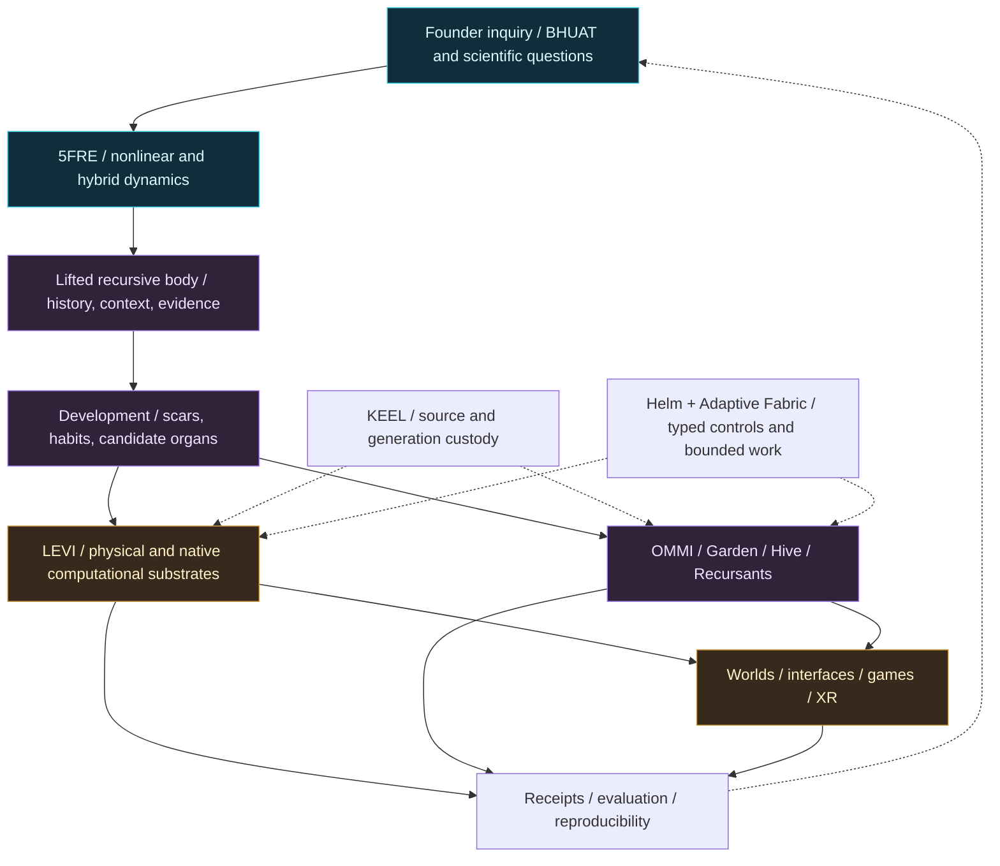

# ONE RESEARCH PROGRAM / MANY SCALES

[Front door](../README.md) | [Minimum Five — foundational hypothesis and theorems](MINIMUM_FIVE.md) | [LEVI — recursive body](LEVI.md) | [LEVI benchmarks](LEVI_BENCHMARKS.md) | [Complex dynamics](COMPLEX_SYSTEMS.md) | [Recursive bodies](AUTOPOIESIS.md) | [Holarchy and neurons](HOLARCHY_NEURONS.md) | [Physical embodiment](EMBODIMENT.md) | [Languages and cryptography](LANGUAGES_CRYPTO.md) | [Worlds and products](WORLDS.md) | [Source ledger](PROVENANCE.md)

> I started by learning how to build and repair physical things. Today I investigate what it would take to build computational systems that retain consequences, develop capabilities, survive changes in substrate and remain answerable for what they do. -- Steven Ray Britt

## The research thesis

**Can a minimum complete five-obligation recursive law generate bounded persistent structure—and can that be one physically realizable route by which reality works? Can a machine built around that law develop useful capabilities without erasing identity, evidence, responsibilities or future choices?**

**BHUAT/5FRE begins with MINIMUM FIVE:** ϕ emergence, τ cadence/order, ψ memory, χ coherence/admissibility and Λ regulation are proposed as the minimum complete independent support functions of recursive bodyhood. The repo's exact ordered-operator dimension theorem and machine-checked fixed-basis/realizer-invariance results establish real mathematical milestones; the wider physical hypothesis is undergoing research, comparison and falsification. **[The foundational Minimum-Five statement and proofs](MINIMUM_FIVE.md).**

This question connects original mathematical models, nonlinear and hybrid dynamics, neural learning, recursive body formalization, organogenesis, physical computation, native software, source custody, distributed execution, interactive worlds and human governance. It is the *research direction* behind BHUAT, 5FRE, LEVI, OMMI, Garden, Hive, KEEL, Helm, Adaptive Fabric and the public Khaotic ecosystem.

The distinctive effort is to connect levels that are often separated: **equations -> implementation -> machine -> developmental history -> controlled action -> human experience -> evidence of what actually happened**.

**LEVI is the embodiment experiment.** Its proposed identity is not a replaceable neural network or a cloud inference task. It is an accountable, non-closed recursive body whose realized characteristics—including possible thermodynamic, geometric and developmental effects—must be discovered through experiments and contrasted with serious baseline systems. [Read the LEVI research identity](LEVI.md), [dated physical frontier](LEVI_PROGRESS.md), and [independent evaluation design](LEVI_BENCHMARKS.md).

## The systems-level map

This is a **conceptual ownership and feedback map**, not a claim that every connection is deployed as an autonomous live service. KEEL stores source/generations, not all semantic truth. Helm navigates typed interfaces; Adaptive Fabric coordinates permitted work; a renderer is not the owner's identity; a program's own source is not proof that it ran on a specific device.

## What the whole effort contains

| Research family | The question | Concrete source type | Current interpretation |
| --- | --- | --- | --- |
| **Foundational nonlinear mathematics** | What can ordered interacting recursive fields express, and what are the exact limits of reduction? | Registered operator, invariants, Jacobians, formalization and numeric suites | Exact scoped results plus open physical interpretation. |
| **Complex and hybrid dynamical systems** | How do continuous or discrete state evolution, events, thresholds, venting, resets, bifurcations and local reduced descriptions interact? | Hybrid-response contracts, event-reduction proposal, viability work | Active mathematics and targeted experimental comparisons; not a universal physical model. |
| **Coupled/N-body holarchies** | How do bounded bodies join, exchange burden, nest into larger systems and retain distinct lineages? | Bodyhood composition, coupling, kernel-instance contracts | Formal and architectural research with different maturity by subsystem. |
| **Neural and adaptive learning** | Can bounded residual learning and graph-structured inference cooperate with an explicit nonlearned state law? | Five-neuron/25-parameter implementation, topological network research | Executable learning component; larger cognition remains a research direction. |
| **Accountable autopoiesis and organogenesis** | When can a repaired or newly specialized component be admitted without silently sacrificing evidence or solvency? | Proof obligations, developmental lifecycle, toy scar-to-organ simulation | Strong explicit research program; simulated organs are not biological or deployed organs. |
| **Knowledge, cognition and memory** | What is the difference between stored events, operational scars, hypotheses, dreams, predictions and admissible actions? | KG families, pass-aware contracts, history/event compaction | Distinct data/authority strata; memory alone does not confer intelligence. |
| **LEVI native physical computing** | Can identity-bearing computation survive boots, device substitution and failures while preserving source and receipts? | UEFI/native code, CPU/GPU tests, body continuity | Boot-scoped and test-scoped milestones; unfinished native device integration. |
| **Android, sensors and spatial bodies** | How do cameras, microphones, displays, movement, pressure and other real physical inputs become controlled, calibrated observer organs? | Android Wand development and somatic-event contracts | Real phone-device research plus future actuation/robotics targets. |
| **LEVI Air and physical-field computing** | Could a recurrent computational state reside partly in wave interactions and physically distributed material rather than only a conventional processor? | Preregistered Air and dense-cloud research ladders | Physical research hypothesis, not a demonstrated autonomous airborne body. |
| **Language, TAL, formal operations** | Can commands carry their own type, preconditions, authority, proof profile and resulting evidence? | Protocol inventories, TAL lineage, proof-carrying operation grammar | Historical designs, current typed surfaces and future compiler targets. |
| **Cryptography and source custody** | How can authority, signatures, privacy, replay defenses and recovery be engineered; how should new cipher ideas be falsified? | Existing standard-crypto capabilities, experimental cipher code, KEEL plans | Distinguish implemented security primitives from **unproven** native cipher research. |
| **Material and physical-science analogues** | Can percolation, elasticity, hysteresis, scar reinforcement, acoustic resonance and topology inform measurable computational models? | Materials/bodyhood bridge, somatic scarring, cymatic research | Controlled analogies and candidate equations, not material/biological law recovery. |
| **Games, worlds, geospatial and XR** | How can user-facing worlds render one governed semantic history at different scales and devices? | Whale Fall world architecture, Machine City, game ecology, native/browser interface work | Real browser/program components and substantial unreleased product goals. |
| **Civic, institutional and social systems** | Can source-backed public evidence, services, collaboration and production institutions be integrated without flattening permissions and provenance? | Historical Machine City, civic maps, founder-intent crosswalks | Source-backed civic architectures, not all institutions operating independently. |
| **Creator and commercial systems** | Can an inventor or creator publish, produce, distribute, and receive verified outcomes across platforms? | Hollywood/production and Khaotic Seas contracts | Select live surfaces; economic/marketplace and full cross-carrier experience remain uneven. |

**Browse:** [Complex systems](COMPLEX_SYSTEMS.md) / [Recursive bodies](AUTOPOIESIS.md) / [Physical embodiments](EMBODIMENT.md) / [TAL and cryptography](LANGUAGES_CRYPTO.md) / [World engines](WORLDS.md) / [Scientific and material bridges](PHYSICAL_SCIENCE.md).

## From observation to evidence

A serious program needs a claim ladder. We use the following, with finer source-specific statuses in the [87-entry pinned research ledger](PROVENANCE.md):

1. **Question / founder intent** - a subject worth investigating, not an empirical result.
2. **Model / specification** - equations, typed objects, system designs, assumptions and known prior art.
3. **Implemented source / simulation** - executable code, controlled fixtures, runs and validator reports.
4. **Scoped theorem / numeric witness** - exact or measured results only for their stated map, parameters and definition.
5. **Physical observation** - specific hardware, version, boot, input, timestamp and receipt.
6. **Reproduced and admitted system capability** - independent comparison, failure controls, safety, authority and release evidence.

A line can move upward only with new evidence. Successful work at one level does not silently promote all dependent levels. An analogy is not proof; a historical branch is not current live state; a physical photograph is not a fully validated capability.

## Selected concrete research checkpoints

**Ordered 5F operator.** The active operator has five interacting fields with fresh sequential predecessor updates. A local exact continuous-realization minimality theorem gives five coordinates on its explicitly defined nondegenerate regions. This does *not* prove the universe uses five fundamental fields. ([R01-R03](PROVENANCE.md))

**Learning seed.** A small Python component implements five bounded field-local trainable neurons with 25 scalar parameters, coupled to rather than replacing the canonical step. Its deterministic rehearsal/checkpoint source is distinct from physical birth or unrestricted learning. ([R64-R65](PROVENANCE.md))

**Scar-to-organ toy model.** A 160-step simulated trace triggered its declared organ event at step 60; the test validator reported zero errors. This is a clear toy experiment showing that the research idea can be expressed and checked in a controlled model. ([R24-R26](PROVENANCE.md))

**CPU/GPU numeric experiment.** A dated September 2026 Linux/RTX 5060 Ti experiment reported 16 launches and CPU-matched tested binary64 traces at zero observed ULP difference under the frozen conditions. It is separate from native standalone LEVI GPU commissioning. ([Evidence ledger](EVIDENCE.md))

**Native LEVI body.** Source and historical receipts establish genuine firmware and boot-specific CPU execution achievements; device onboarding, memory/identity admission and autonomy are independent remaining acceptance boundaries. ([R35-R41](PROVENANCE.md))

**Cipher research.** A finite-bit KPP-320 research implementation exists in Rust with explicit experimental-only status; secure production cryptography needs independent cryptanalysis, side-channel work and deployment review. ([R76-R79](PROVENANCE.md))

## What it means for a collaborator

I can contribute practical experience in machinery and controls, plus independent scientific investigation, native systems and AI-assisted engineering. A collaborator can engage at many levels without accepting the whole BHUAT physical interpretation: challenge the mathematical operator, reproduce a simulation, benchmark the learning seed, review a type/effect contract, validate a device boundary, assess a UI slice, or test a real deployment interface.

The current highest-value engineering step is **integration with receipts**: demonstrate one reproducible cross-owner journey from an observation or user intent through proper authority and native execution into an inspectable result, preserving the same source and body identity. The October whole-system audit explicitly identifies this integration gap.

The work aims to develop **systems that improve through documented experience**, not a slogan about sentience. Whether biological life, cognition or physical-law recovery eventually becomes a meaningful comparison is a separate falsifiable question, not a marketing assumption.

## Intellectual property and attribution

The project includes two recorded U.S. patent application filings, protected invention material and private source not reproduced here. Public research summaries are curated for collaboration. Publishing an evidence summary does not release private source, waive rights, certify patent claims or grant implementation permission.

**Start with the [source ledger](PROVENANCE.md).** It names primary documents and their maturity, limitations and original paths. This page is a synthesis and invitation to independent review, not a new canonical source owner.
