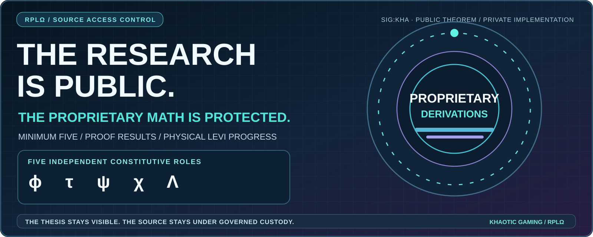

# THE PUBLIC THEOREM / THE PRIVATE WORK

### Khaotic Gaming LLC · Khaotic.ai · Recursive Physics Lab (RPLΩ) · Sig:KHA

[Return to the flagship front door](../README.md) · [Minimum Five](MINIMUM_FIVE.md) · [LEVI](LEVI.md) · [Research program](RESEARCH.md) · [Research provenance](PROVENANCE.md)

> **THE AMBITION IS PUBLIC. THE MATHEMATICAL IMPLEMENTATION IS PROTECTED.**
>
> We are not removing the science, hiding the entire research program or recasting decades of work as a vague idea. We are drawing a deliberate boundary between **the thesis, the evidence and the proprietary machinery that makes it work.**

## Why the public material is redacted

**BHUAT proposes one mathematically realizable route by which reality can generate and sustain bounded recursive structure.** The **Five-Field Recursion Engine (5FRE)** is the mathematical and computational development of that proposal. Its declared Minimum-Five support constitution remains publicly identified as:

**ϕ emergence · τ ordering · ψ memory · χ coherence · Λ regulation**

The existence, structure, scope and results of the investigations matter to prospective colleagues, industry partners, universities, critical reviewers, potential funders, and the general public. So do the tests, hardware milestones and documented negative results.

The exact construction of an original mathematical model is different. **Publishing working update rules, parameter bindings, derivations, proprietary proof scripts, or executable replicas would disclose implementation-level work that the public front door does not need to disclose.**

This publication therefore uses **visible redaction notices** in the appropriate places. We keep the headings, research programs, theorem summaries, experimental outcomes, technical questions, attribution and contact paths intact.

## What the disclosure boundary means

| Public layer | What remains readable | What is withheld |
| --- | --- | --- |
| **Foundational thesis** | Minimum Five, the five named obligations, BHUAT's physical hypothesis, claimed mathematical significance. | Proprietary source-generation construction, pre-field operator correspondence and implementation-level formal definitions. |
| **Exact mathematics** | Stated theorem outcomes, hypothesis conditions in ordinary language, scope of local minimality and proof claims. | Registered recurrences, equation coefficients, exact Jacobian factors, symbolic reductions, source-specific parameter profiles, proof internals and private working notes. |
| **Complex / hybrid dynamics** | Research families, event/guard questions, viability, attractors, holarchy and falsification programs. | Exact vent/reset kernels, thresholds, coupling parameters, stabilization methods and proprietary realization recipes. |
| **LEVI hardware and development** | Actual photos, dated milestones, CPU/GPU engineering record, identity/continuity research and open acceptance gates. | Boot secrets, authenticated control material, unreleased firmware internals, protected interface details and private methods. |
| **Evidence and comparison** | Publicly disclosed numerical outcomes, verified claims and their limitations, negative results, proposed benchmarks. | Unreleased raw datasets, private source builds, proprietary test fixtures, proof payloads and non-public attribution records. |
| **Interactive explorer** | Visual five-field concepts, clearly labeled conceptual animation, evidence filters and benchmark preregistration. | Canonical 5FRE update logic, actual coefficient choices, proprietary initialization, physical telemetry, uncommissioned computation. |

The public explorer is **a conceptual visualization**. It does not compute the protected 5FRE recurrence and must never be mistaken for a live LEVI body trace.

## Research access and collaboration

Researchers and partners can begin with the public theory, source-backed results, challenge questions and engineering history. For deeper review, use the contact below to describe the work, institution or area of expertise, and the specific claim or experiment being examined.

A further disclosure may require a suitable scope of collaboration, attribution understanding and confidentiality or licensing terms. **No private source, formula, proof object or implementation is automatically released through this public profile.**

**[Contact the lab about mathematical review](mailto:admin@khaotic.ai?subject=Confidential%20BHUAT%20Research%20Review)** · **[Propose a Minimum-Five challenge](../docs/OPEN_LAB.md)** · **[Review the public engineering journal](LEVI_JOURNAL.md)**

## Research credibility without source disclosure

A private derivation does not establish a public scientific result by itself. **The public statements remain precise about what they claim and what independent reviewers can presently examine.** Scoped local exactness, the machine-checked independent support result and admitted realizer invariance are described at the level needed to distinguish them from broader physical claims.

The program still invites independent evaluation. **Verification of a withheld proof may require controlled access, an independent auditor, or additional publishable artifacts.** An unshared proof cannot be represented as externally reproduced merely because its conclusion appears in a portfolio.

The user's original industrial practice, physical computing, inventorship, and experimental work remain visible. This access boundary is not a limitation on that experience.

## GitHub history remediation — November 3, 2026

> **PUBLIC BRANCH REWRITE ≠ GLOBAL DELETION.**
>
> The public **main** branch was rewritten on November 3, 2026 to replace identified historical private-history details and protected mathematical implementation fragments with redaction notices. The current public file tree was preserved **byte-for-byte**, and a targeted scan of the rewritten reachable text history returned **zero matches**. All ten obsolete merged profile branches were retired from the public repository. The original history was preserved in a restricted, owner-controlled backup for recovery and authorized custody.
>
> **GitHub-managed pull-request references, historical cached views, and copies held outside this repository may still exist.** A repository force-push and branch removal cannot by themselves make previous public publication secret again. GitHub Support remediation remains a separate follow-up. The research lab makes **no claim that external caches or third-party copies have been purged**.
>
> The private canonical research repository and the physical LEVI chassis were **not changed** by this profile-history operation. Future work must avoid merging a pre-cleanup clone in a way that reintroduces the previously published material.

## Intellectual property and attribution

**Researcher / inventor:** Steven Ray Britt (Mr Khaotic), Khaotic Gaming LLC / Recursive Physics Lab.

The public portfolio records invention filings and research history. Filing and attribution information is not a blanket license to use the proprietary implementations. A public abstract is not a source-code release, an open patent license, a claim of peer review, or an offer to transfer IP.

**The work stays ambitious. The public presentation stays powerful. The underlying original mathematical machinery stays protected.**

[Founder profile](../README.md) · [Minimum Five research statement](MINIMUM_FIVE.md) · [LEVI body experiment](LEVI.md) · [Research contact](mailto:admin@khaotic.ai?subject=Research%20Collaboration)
