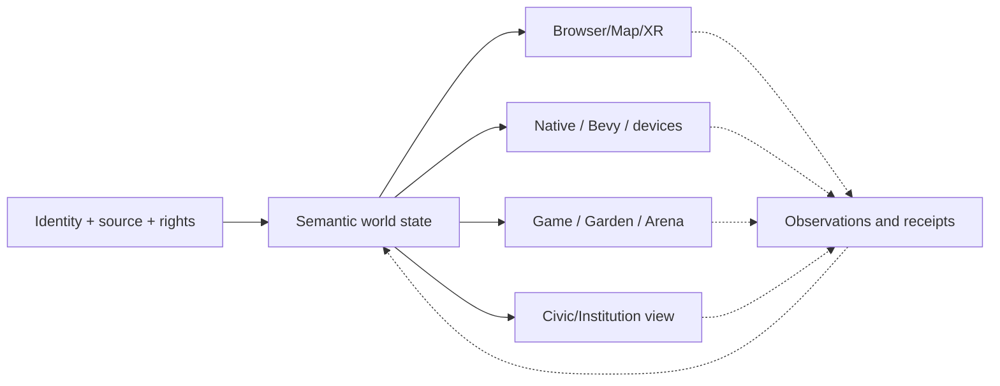

# WORLD ENGINES / GAMES / CIVIC SYSTEMS / CREATOR ECOSYSTEM

[Front door](../README.md) | [Research program](RESEARCH.md) | [Embodied computing](EMBODIMENT.md) | [Engineering resume](ENGINEERING.md) | [Sources](PROVENANCE.md)

## Why a lifelong gamer builds worlds

Gaming has been part of my life since the old-school era of interactive computers and consoles. It taught me to think about rules, maps, play, progression, possibility spaces and what makes a virtual environment meaningful to the person inside it. Construction and industrial work taught me the other side: machines, resources, serviceability, hidden infrastructure and consequences.

Khaotic Gaming brings those perspectives together. **Whale Fall, Machine City, the Garden, LEVI and the game/ecology programs are not interchangeable names.** They describe different parts of a potential connected experience and different software and governance responsibilities.

## One experience, multiple actual owners

| Domain | What it means | Implementation/evidence boundary |
| --- | --- | --- |
| **Khaotic.ai** | Public home, introduction, owned product and research entrance | Real public surfaces and curated evidence, not the native source authority. |
| **Historical Atlas / Research Estate** | Dated system map, lineage, research dossiers and source-backed evidence crosswalk | A public reviewed projection, not exhaustive private repo disclosure or live chassis proof. |
| **Whale Fall** | Founder-intended navigable world/site-of-sites and a separate world/evidence software substrate | Existing browser world features; larger creator/game experience remains incomplete. |
| **World Engine** | Semantic subject, generated world, viewport, geography, scale, renderer and time-domain translation | Source-backed identity/renderer contracts; generation admission differs from world publication. |
| **Machine City** | Institutional/service/creative organization of tools, workers, education and civic functions | Recovered role contracts and source; a civic office is not automatically a deployed process. |
| **Garden / Gym / Cathedral** | Developmental training, testing, classification and review of possible behaviors | Component code and design exist; end-to-end autonomous cultivation not assumed. |
| **Hive / Recursants** | Distinct specialist bodies, private development, culture and controlled knowledge exchange | A shared structure does not create common raw memory or erase identity. |
| **Seasonal game / Egg / Arena** | Game-facing embodiment of different seeds, developmental behavior and population pressures | Product/game research; no implied live paid-mint economy or external-device control. |
| **Khaotic Seas** | Interoperable modular software/hardware/service composition across existing platforms | Architecture and partial staged routes, not universal compatibility. |
| **XR / Bevy / browser / Android** | Multiple presentation and interaction carriers for shared typed subjects and world state | A renderer is a projection; browser UI does not own authoritative body lineage. |
| **Hollywood / Living Score / media** | Creative production, real capture, simulation, music/score, scene composition and publication receipts | Different components at different maturity, not a completed studio or autonomous posting grant. |
| **Commerce and civic/public projects** | Rights, creators, exchange, public evidence and possible institutional workflows | Legal, economic and real-world actions need separate validation and explicit authority. |

## The World Engine has to preserve meaning across views

A map viewer, a solar-scale presentation, a native 3D room and a virtual institution can show different projections of the *same semantic subject* without having equal authority over that subject. The Whale Fall research distinguishes world identity, generation identity, source root, renderer package, geographic scope, camera/view frame, scale and multiple incompatible notions of time.

The October source audit identified implemented browser-world code, geography hierarchy, temporal/analytical lenses, recovery/quality controls and source-bound transition ideas. However, this does not certify exact frame rates, every native renderer, full world generation admission or a commercially complete gaming platform (R48, R52, R82).

This is a proposed composition shape. The reverse arrow requires separately authorized and attributable events; the mere presence of a user interface does not write canon or make source data true.

## What makes the game an instrument

The seasonal ecology asks whether separately seeded recursive bodies can develop different behaviors in different conditions. The game is an opportunity to express complex dynamics as choices, environments, consequences and competition. **Play is not scientific proof by itself.** A fair benchmark must specify seeds, mechanics, instrumentation, constraints, baselines, rewards, forbidden behaviors and evaluation criteria.

The intended player progression uses Black/Null Egg, inspected genesis, accepted lineage, Garden training, Gym/Arena testing, behavior blocks, scars, repaired weaknesses, seasonal challenge and potential future specialized organs. The project also explores a Living Score: artistic/musical representation of technical events. Such scenes can be compelling while remaining explicitly labeled by maturity and provenance (R31-R34).

## Machine City means useful institutions, not infinite bots

The recovered City includes human-readable professional and institutional structures for technical work, medicine/repair analogies, civic resource management, education, libraries, scientific review, creation and production. Some real tools and services support parts of those functions. Others remain named architectures or historical source artifacts. The whole-system deep dive expressly warns against counting every role, profession, worker definition or building as a separate deployed autonomous agent (R42, R48-R50).

A meaningful demonstration is simpler than rebuilding the whole city: **enter one world, select one institution, view its legitimate read model, inspect sources, carry out one separately authorized task if appropriate, receive the evidence, and leave with the same subject identity and history.**

## Public benefit and creative work belong inside the scope

The broader program also investigates source-backed civic research, geospatial records, accountable institutional action, creator rights, game and XR education, media production, modular commerce and shared public interfaces. Those are not afterthoughts to the equations: they are ways the engineering could become useful to people. Conversely, ambitious product possibilities cannot be presented as existing contracts, legal entitlements, verified public datasets or monetized services without explicit evidence.

**Source families:** R31-R34, R42-R57, R82-R85. [Research program](RESEARCH.md) | [Public evidence register](PROVENANCE.md) | [Khaotic.ai](https://khaotic.ai/).
